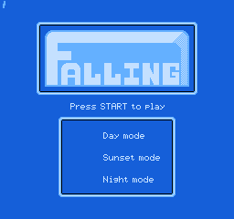
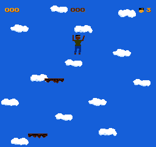

# GEM6502

GEM6502 is a **fast C cycle model** for the Open6502 SoC. It borrows the useful
parts of GEM5's structure without trying to be GEM5:

- a global event queue,
- explicit clock/cycle accounting,
- SimObject-like CPU/PPU/APU/bus separation,
- statistics and trace hooks,
- deterministic cycle counts for 6502 instructions.

It is intended for:

- fast boot/regression of 6502 programs without an RTL simulator,
- cycle-budget exploration before RTL changes,
- NEMU/RTL model comparison,
- CI smoke tests that need a programmable 6502 SoC model.

It is **not** a replacement for NEMU, Verilator, or signoff simulation.

## Build

```sh
cd GEM6502
make
make test
```

The test binary is `tests/test_gem6502`; the CLI is `./gem6502`.

## Run

```sh
./gem6502 run <prg.bin> [max_cycles] [--trace]
./gem6502 stats <prg.bin>
```

`prg.bin` is a raw NROM PRG image loaded at `$8000`. The reset vector is read
from `$FFFC/$FFFD`, so a 32 KiB NES PRG can be used directly if it is NROM.

Example:

```sh
./gem6502 run /tmp/gem-demo.bin 1000
```

Output:

```text
GEM6502 0.1.0
pc=8037 a=15 x=00 y=00 sp=FD p=24
cycles=101 inst=49 reads=57 writes=1 frames=0 nmi=0 illegal=0
stop=cycle limit
```

## Run a game

GEM6502 can load an iNES mapper-0 ROM, run the CPU/PPU and render a PPM frame:

```sh
./gem6502 game ../roms/falling.nes 60 /tmp/gem-title.ppm
./gem6502 game ../roms/falling.nes 120 /tmp/gem-game.ppm --start
```

Title screen:



Gameplay after START:



Convert PPM to PNG:

```sh
python3 -c 'from PIL import Image; Image.open("/tmp/gem-game.ppm").save("/tmp/gem-game.png")'
```

## GEM5 mapping

| GEM5 concept | GEM6502 implementation |
|---|---|
| SimObject | `GemCpu`, `GemPpu`, `GemApu`, `GemBus` |
| Event queue | `GemEventQueue` min-heap |
| Clock domain | CPU cycles drive PPU/APU advancement |
| Statistics | `GemStats` |
| Trace | CPU trace flag / bus counters |
| Memory object | RAM, PRG, CHR, VRAM, OAM, palette arrays |
| Checkpointing | not implemented yet |

## Architecture

```text
main.c
  gem_create / gem_load_prg / gem_run

gem6502.c
  cpu_step       6502 instruction + cycle count
  gem_bus_read   RAM / PPU / APU / cartridge decode
  gem_bus_write  PPU/APU/$4014/OAM DMA/controller
  gem_ppu_advance  CPU cycles -> PPU dots -> vblank/NMI
  gem_apu_advance  APU cycle counter
  gem_run_events  event queue dispatch
```

The PPU is advanced lazily by `cpu_cycles * 3`, not by one event per dot. This
is the key speed tradeoff: the model is fast, but it does not model per-dot
PPU/CPU interleaving exactly.

## Instruction coverage

Implemented NMOS 6502 official instructions and common NOPs:

- loads/stores, all documented addressing modes
- ADC/SBC with binary and decimal mode
- AND/ORA/EOR, CMP/CPX/CPY, BIT
- INC/DEC, ASL/LSR/ROL/ROR
- branches with page-cross cycles
- JMP/JSR/RTS, BRK/RTI
- PHA/PLA/PHP/PLP
- transfers and flag instructions
- NOP

The opcode table is in `src/gem6502.c`. Undocumented opcodes and most 65C02
extensions are intentionally illegal.

## Current limitations

- IRQ is a simple level model with the 240 Hz APU frame sequencer; no mapper IRQ yet.
- PPU renderer is a compact background/sprite rasterizer, not a dot-exact PPU.
- No per-dot PPU/CPU interleaving.
- No APU audio synthesis; register file only.
- Mapper 0 only in the game loader; no MMC1/MMC3 banking yet.
- No cycle-exact bus stalls for every PPU register access.
- No checkpoint/restore.
- No C++/Python bindings.

These are deliberate v0.1 boundaries.

## Tests

```sh
make test
```

Current unit tests:

```text
PASS: GEM6502 ALU/branch/cycle count
PASS: GEM6502 JSR/RTS stack
PASS: GEM6502 IRQ/RTI
PASS: GEM6502 PPU vblank/NMI
ALL GEM6502 TESTS PASS
```

### Module tests

`make test` also builds and runs:

```text
PASS: all iNES tests
ALL GEM6502 RENDER TESTS PASS
```

### Multi-game smoke

```sh
make games
```

Current NROM results:

```text
falling        colors=4  black=880
galaxypatrol   colors=8  black=59335
hanoi          colors=3  black=0
table_tennis   colors=3  black=56842
PASS: GEM6502 NROM game smoke
```

### NEMU golden-state diff

```sh
make difftest
```

This runs directed programs in both NEMU and GEM6502, then compares the full
state trace: PC, A, X, Y, SP, P (B/U masked), and zero-page checkpoints.

Current cases:

```text
alu       PASS
decimal   PASS
stack     PASS
branch    PASS
rmw       PASS
brk       PASS
```

Each case currently matches for 25-35 instructions.

## Roadmap

1. Add NMI/IRQ priority and mapper IRQ tests.
2. Add mapper 1/2/3/4/7 banking.
3. Add frame hash comparison against NEMU for multiple games.
4. Add APU frame sequencer and audio sample output.
5. Add checkpoint/restore.
6. Add cocotb/C API bindings.
7. Add NEMU/RTL/GEM6502 three-way trace comparison.
8. Feed GEM6502 timing data back into RTL verification.
