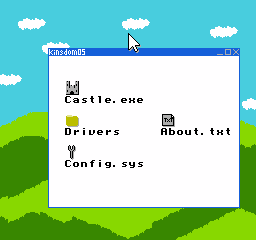
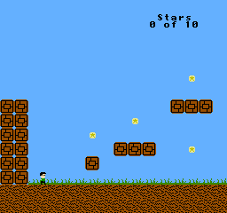

# GEM6502

Development version: **v0.2.0-dev**. Preserved legacy baseline: **v0.1.0**,
tag `gem6502-v0.1.0`.
See [release notes](releases/0.1.0.md).

GEM6502 is being redesigned as a gem5-style, event-driven architecture and
timing simulation platform for the Open6502 SoC. The target includes timing
ports, clock domains, resource contention, DMA arbitration, checkpoints,
causal statistics, and independently calibrated RTL comparison.

**The current implementation is a legacy instruction-driven functional/cycle
model, not the completed chip timing platform.** Its event queue does not yet
drive normal execution. Games, cycle counts, and NEMU trace matches are useful
regression assets, but do not establish chip-level timing fidelity.

The normative target and implementation rules are defined in:

- [Requirements and acceptance gates](docs/requirements.md) (Chinese)
- [Architecture and coding guide](docs/coding-guide.md) (Chinese)

These documents describe required future capabilities. Existing commands below
run the current legacy model; proposed timing APIs and build targets in the
design documents are not implemented yet. The target is architecture and
microarchitecture timing simulation, not RTL/netlist execution or silicon
signoff. GEM6502 is not a gem5 fork or a gem5 API-compatible implementation.

## Experimental timing development

The new kernel is independent of the legacy player and interpreter. Run
`make test-kernel` for deterministic scheduling and clock-boundary tests.
G0/G1 remain partial; no timing CPU or calibrated chip profile is available.
See [development status and initial decisions](spec/development-status.md).

## Build

```sh
cd GEM6502
make
make test
```

The test binary is `tests/test_gem6502`; the CLI is `./gem6502`.

## Run

```sh
./gem6502 run <prg.bin> [max_cycles] [--trace]
./gem6502 stats <prg.bin>
```

`prg.bin` is a raw NROM PRG image loaded at `$8000`. The reset vector is read
from `$FFFC/$FFFD`, so a 32 KiB NES PRG can be used directly if it is NROM.

Example:

```sh
./gem6502 run /tmp/gem-demo.bin 1000
```

Output:

```text
GEM6502 0.1.0
pc=8037 a=15 x=00 y=00 sp=FD p=24
cycles=101 inst=49 reads=57 writes=1 frames=0 nmi=0 illegal=0
stop=cycle limit
```

## Interactive player

With SDL2 installed (`sdl2-config` on PATH), `make` includes the desktop player.
On macOS, install the dependency with `brew install sdl2` if needed, then run
`make -B` to rebuild. Without SDL2, the command-line simulation still builds;
`play` reports the missing dependency.

```sh
./gem6502 play ../roms/file-fixers.nes
./gem6502 play ../roms/stallar.nes
```

The resizable window has a game view and clickable START, PAUSE/RESUME, RESET,
HELP, MUTE, and QUIT buttons. START is held while the mouse button is down. The
simulation runs at approximately 60 NTSC frames per second, pauses when the
window loses focus, and clears held keys to prevent stuck input. Click RESUME
or press P to resume. HELP also freezes the game while showing the controls.

| Key | Action |
|---|---|
| Arrows or W/A/S/D | Move |
| Space or Z / X | NES A (jump) / B |
| Enter / Backspace | START / SELECT |
| P | Pause / resume |
| R | Restart ROM from power-on state |
| F1 | Toggle controls help |
| M | Mute / unmute |
| Esc | Quit |

The player controls port 1 with the keyboard and plays 44.1 kHz mono audio
through SDL2. Pulse, triangle, noise, and DMC synthesis are adapted from the
NEMU APU model. There is no gamepad support yet. Reset clears volatile cartridge RAM as well
as CPU/PPU state. Rendering captures the register and CHR bank state at each visible PPU dot,
while CPU/PPU advancement remains instruction-granular.

The title bar reports `Sound on`, `Muted`, or `Audio unavailable`. Press Enter
to start gameplay; some title screens are silent. If opening the output device
fails, the player reports SDL's error and continues without audio. Pause/help,
focus loss, mute, and reset clear queued samples; the queue is bounded to avoid
long sound delays. Output uses the system's default audio device.

`make test` checks silence, sample count, pulse pitch, triangle/noise output,
and nonconstant PCM from both bundled MMC3 games. `make test-ui` additionally
checks SDL queue submission and mute clearing with the dummy audio driver.

```sh
make test-ui
```

This uses SDL's dummy video driver to exercise the real event handler, input
serialization, mouse buttons, focus loss, pause/help/reset/quit, texture upload,
and rendering. Both MMC3 games receive START press/release events and run for
240 frames. `make test difftest games mmc3` covers the headless regressions.

## Browser player (WebAssembly)

The functional core also runs in the browser as a ~30 KB freestanding
WebAssembly module. Rendering, input and audio scheduling live in
`web/player.js`; the module itself has no Emscripten or WASI imports.

```sh
cd web
./build.sh
python3 -m http.server 8000   # open http://localhost:8000/
```

Frames are byte-identical to the native `game` command, and `make web-test`
checks that with `cmp`. The same player is embedded in the project website's
Play section (`site/index.html`), refreshed with `./site/sync-play.sh`.
See [web/README.md](web/README.md) for the module ABI, build requirements and
known limits.

## Run a game

GEM6502 can load an iNES mapper-0 ROM, run the CPU/PPU and render a PPM frame:

```sh
./gem6502 game ../roms/falling.nes 60 /tmp/gem-title.ppm
./gem6502 game ../roms/falling.nes 120 /tmp/gem-game.ppm --start
./gem6502 game ../roms/stallar.nes 600 /tmp/replay.ppm --replay-input=/tmp/input.bin
```

Title screen:


Gameplay after START:


Convert PPM to PNG:

```sh
python3 -c 'from PIL import Image; Image.open("/tmp/gem-game.ppm").save("/tmp/gem-game.png")'
```

## MMC3 games and timing regression

The bundled mapper-4 games now run past the former frame-6 crash:

```sh
./gem6502 game ../roms/file-fixers.nes 600 /tmp/file-fixers.ppm --start
./gem6502 game ../roms/stallar.nes 600 /tmp/stallar.ppm --start
make mmc3
```

`make mmc3` requires the built `../NEMU/build/6502EMU`. It compares every CPU
register, CPU cycle count, and PPU scanline/dot boundary for 60 title frames in
each ROM, then runs each for 600 frames with START and checks completion,
illegal-opcode count, and nonblank image output. Trace files are temporary. The regression also replays 1,200 frames of Stallar
movement and repeated jumps, comparing the full CPU/clock trace and final
framebuffer byte-for-byte against NEMU at frames 240, 360, 480, 600 and 1,200;
full traces are compared at frames 600 and 1,200.
NEMU traces PPU phase before advancement and GEM traces after advancement;
the comparator aligns these boundaries explicitly.

The fix separates 8 KiB cartridge PRG RAM from internal CPU RAM (the previous
alias overwrote zero page and stack), accounts for all 513 OAM DMA cycles in
CPU/PPU/APU/global clocks, and retains the rendering-dependent odd-frame dot
skip. MMC3 CHR bank inversion and nametable mirroring are shared by PPU reads,
sprite-hit sampling, and frame rendering. This remains a fast instruction-level
model rather than a hardware dot-exact implementation. Frame output now preserves scan-time register/bank/palette state rather than
repainting the whole frame with its final state. Scroll writes use separate
current/temporary PPU addresses and fine X; visible-line Y increments and
horizontal reloads follow the NEMU reference. The legacy model latches pending mapper IRQs at instruction boundaries to
match NEMU. This is a compatibility rule that must be revalidated against
the selected chip profile before reuse in the timing model.

File Fixers after START:



Stallar after START:



## Legacy scaffolding and target gaps

These structures are migration assets, not completed gem5-equivalent capabilities.

| Target capability | Current legacy implementation and limitation |
|---|---|
| Component lifecycle and ports | Device structs with direct cross-component access |
| Event-driven scheduling | Min-heap API; normal execution does not use it |
| Independent clock domains | PPU/APU advanced in batches after CPU instructions |
| Performance statistics | Basic counters; no modeled queue/contending-resource delays |
| Transaction tracing | CPU state traces and bus counters; no full transaction protocol |
| Timing memory objects | Direct arrays and synchronous accesses |
| Checkpointing | Not implemented |

## Current legacy architecture

```text
main.c / frontend.c
  command-line simulation / SDL2 interactive player

cartridge.c
  shared iNES loader for headless and interactive modes

gem6502.c
  cpu_step       6502 instruction + cycle count
  gem_bus_read   RAM / PPU / APU / cartridge decode
  gem_bus_write  PPU/APU/$4014/OAM DMA/controller
  gem_ppu_advance  CPU cycles -> PPU dots -> vblank/NMI
  gem_apu_advance  APU cycle counter and PCM synthesis
  gem_run_events  event queue dispatch
```

The PPU is advanced lazily by `cpu_cycles * 3`, not by one event per dot. This
is the key speed tradeoff: the model is fast, but it does not model per-dot
PPU/CPU interleaving exactly.

## Bus inspection

`gem_bus_read(gem, address, false)` peeks at a register without clearing PPU
status/APU IRQ, advancing the PPU data buffer/address, shifting controllers,
or increasing the read counter. CPU and OAM DMA reads pass `true` to perform
normal bus reads. PPUDATA palette reads return palette data immediately,
refill the delayed buffer from the underlying nametable, and advance the
address using PPUCTRL's increment setting.

## Instruction coverage

Implemented NMOS 6502 official instructions and common NOPs:

- loads/stores, all documented addressing modes
- ADC/SBC with binary and decimal mode
- AND/ORA/EOR, CMP/CPX/CPY, BIT
- INC/DEC, ASL/LSR/ROL/ROR
- branches with page-cross cycles
- JMP/JSR/RTS, BRK/RTI
- PHA/PLA/PHP/PLP
- transfers and flag instructions
- NOP

The opcode table is in `src/gem6502.c`. Undocumented opcodes and most 65C02
extensions are intentionally illegal.

## Current limitations

- IRQ is a simple level model with the 240 Hz APU frame sequencer; no mapper IRQ yet.
- PPU renderer is a compact background/sprite rasterizer, not a dot-exact PPU.
- No per-dot PPU/CPU interleaving.
- Audio synthesis is approximate; DMC bus stalls and audio IRQ delivery are
  not yet integrated with the CPU timing model.
- Mapper 0/1/2/3/7 bus mapping is present.
- MMC3 (mapper 4) PRG banking and A12 IRQ have unit coverage.
- Bundled MMC3 games pass 60-frame CPU/cycle/PPU-phase comparison against NEMU
  and 600-frame START gameplay smoke. MMC3 IRQ uses NEMU-compatible visible
  scanline callbacks; hardware A12 filtering is still approximate.
- No cycle-exact bus stalls for every PPU register access.
- No checkpoint/restore.
- No C++/Python bindings.

These are deliberate v0.1 boundaries.

## Tests

```sh
make test
```

Current unit tests:

```text
PASS: GEM6502 ALU/branch/cycle count
PASS: GEM6502 JSR/RTS stack
PASS: GEM6502 IRQ/RTI
PASS: GEM6502 MMC3 banks/A12 IRQ
PASS: GEM6502 PPU vblank/NMI
ALL GEM6502 TESTS PASS
```

### Module tests

`make test` also builds and runs:

```text
PASS: all iNES tests
ALL GEM6502 RENDER TESTS PASS
```

### Multi-game smoke

```sh
make games
```

Current NROM results:

```text
falling        colors=4  black=880
galaxypatrol   colors=7  black=61264
hanoi          colors=3  black=0
table_tennis   colors=4  black=53563
PASS: GEM6502 NROM game smoke
```

Input replay uses NEMU's `NESINP01` format: an 8-byte magic followed by two
controller bytes per frame (port 1, port 2). Missing frames release all buttons.
This allows both emulators to reproduce the same movement sequence.

### NEMU golden-state diff

```sh
make difftest
```

This runs directed programs in both NEMU and GEM6502, then compares the full
state trace: PC, A, X, Y, SP, P (B/U masked), and zero-page checkpoints.

Current cases:

```text
alu       PASS
decimal   PASS
stack     PASS
branch    PASS
rmw       PASS
brk       PASS
```

Each case currently matches for 25-35 instructions.

## Architecture and timing roadmap

Development follows the mandatory gates in [the requirements](docs/requirements.md):

1. G0: freeze chip profiles, sampling phases, memory and interrupt contracts.
2. G1: make the event kernel, object lifecycle and clock domains drive execution.
3. G2: implement timing ports, asynchronous transactions and resource arbitration.
4. G3: implement the timing CPU and validate visible bus cycles.
5. G4: integrate real DMA requests, PPU/mapper fetch events and unified APU timing.
6. G5: provide configuration, causal statistics, checkpoints and RTL comparison.
7. G6: publish independent calibration evidence and supported accuracy limits.

Game compatibility and UI additions are regression/support work and do not
count as completion of these architecture gates. Existing NEMU matches must
not be represented as independent hardware timing calibration.
