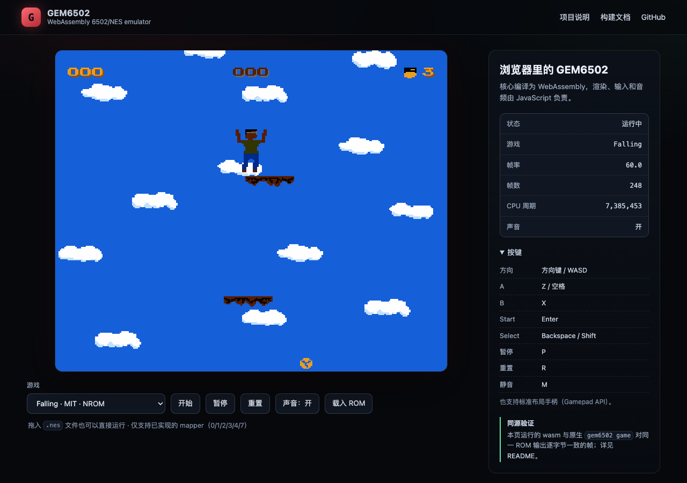

# GEM6502 · WebAssembly player

在浏览器里直接运行 GEM6502 的 6502/NES 功能核心。

- 核心（CPU/PPU/APU/总线/卡带）编译为 **freestanding WebAssembly**，约 **30 KB**；
- 不依赖 Emscripten、WASI 或任何 JS 胶水运行时，模块不导入宿主函数；
- 渲染、输入、音频调度和帧节奏由 `player.js` 负责；
- 与原生 `./gem6502 game` 对同一 ROM 输出**逐字节一致**的帧。



同一套播放器也已嵌入项目官网的 Play 区（`site/index.html`）；
站点侧是生成产物，更新核心后执行 `./site/sync-play.sh` 同步。

## 快速开始

```sh
cd GEM6502/web
./build.sh                 # 生成 gem6502.wasm
python3 -m http.server 8000
# 打开 http://localhost:8000/
```

必须通过 HTTP 打开。`file://` 下浏览器会拒绝 fetch 本地 `.wasm` 文件。

## 构建要求

| 依赖 | 说明 |
| --- | --- |
| clang（wasm32 target） | Homebrew LLVM 21 验证通过；Apple clang 不带 wasm target |
| wasm 链接器 | 默认使用 Rust 工具链自带的 `rust-lld -flavor wasm`；也可用 `RUST_LLD=/path/to/rust-lld` 指定 |
| Node.js | 仅 `test/run-node.mjs` 和一致性测试需要 |

`build.sh` 会依次尝试 `rustc --print sysroot` 和 `~/.rustup/toolchains/*` 下的
`rust-lld`，并在调用链接器时临时设置库路径（不会影响 clang）。

不需要 emcc/emsdk。

## 目录结构

```text
web/
├── build.sh              # clang wasm32 + rust-lld，无 Emscripten
├── gem6502.wasm          # 构建产物（随仓库提供，便于静态部署）
├── index.html            # 播放器页面
├── style.css
├── player.js             # Canvas / WebAudio / 键盘 / 手柄 / 触屏
├── src/
│   ├── gem_web.c         # 导出给 JS 的 C ABI
│   └── shim/             # 极简 libc（malloc、string、stdio 桩）
├── test/
│   ├── run-node.mjs      # 无浏览器冒烟测试
│   └── compare.sh        # 与原生渲染逐字节对比
└── roms/                 # 仓库内 MIT 授权 ROM，仅用于测试
```

## 模块 ABI

| 导出 | 作用 |
| --- | --- |
| `gem_web_init()` | 创建并复位核心 |
| `gem_web_load_rom(ptr, len)` | 从线性内存加载 iNES 镜像，返回 0 成功 |
| `gem_web_rom_buffer()` / `gem_web_rom_capacity()` | 供 JS 写入 ROM 的暂存区 |
| `gem_web_run_frame()` | 跑到 PPU 帧边界，返回是否产出新帧 |
| `gem_web_framebuffer()` | 渲染为 RGB24，返回指针 |
| `gem_web_framebuffer_rgba()` | 同上，RGBA8888，直接喂 Canvas ImageData |
| `gem_web_take_audio(max)` / `gem_web_audio_buffer()` | 取出 44.1 kHz 单声道 int16 PCM |
| `gem_web_set_buttons(j1, j2)` | NES 手柄位掩码（A=1, B=2, Select=4, Start=8, 方向=0x10…0x80） |
| `gem_web_error()` | 最近一次加载错误（C 字符串） |
| `gem_web_frames()` / `gem_web_cycles()` / `gem_web_halted()` | 统计信息 |

JS 侧只需要 `WebAssembly.instantiate(bytes, {})`，不传任何 import。

## 与原生实现的一致性

```sh
cd GEM6502
./web/build.sh
./web/test/compare.sh ../roms/falling.nes 60
# 或
make -s web-test
```

`compare.sh` 会用同一 ROM、同样帧数分别跑 wasm 和原生 `./gem6502 game`，
然后 `cmp` 两份 PPM。当前 `falling`、`galaxypatrol`、`hanoi`、`table_tennis`
四款 ROM 的第 60 帧全部逐字节一致。

## 实现要点

1. **核心零改动（除两个新增 API）**：渲染仍由 `gem_render_frame()` 输出
   RGB24，音频仍由 `gem_sound_take_samples()` 输出 PCM；新增的只有
   `gem_ines_parse()` 和 `gem_load_game_memory()`，让没有文件系统的宿主也能加载 ROM。
2. **帧边界**：`gem_web_run_frame()` 循环 `gem_step()` 直到 `stats.ppu_frames`
   自增，因此 JS 的每一帧就是一个完整 PPU 帧，不需要自己数周期。
3. **像素格式**：RGB24 → RGBA 的转换放在 C 里做，避免每帧在 JS 中跑 6 万次循环。
4. **音频**：每帧取一次 PCM，转成 `AudioBuffer` 后按 `currentTime` 排队；
   队列落后超过 350 ms 时重置，避免切后台回来后出现声音雪崩。
5. **节奏**：`requestAnimationFrame` 累加器按 60.0988 Hz 推进，单次最多追 2 帧；
   页面隐藏时自动暂停。
6. **libc**：`src/shim` 提供 malloc/free（地址有序的空闲链表 + `memory.grow`）、
   mem/str 函数、`vsnprintf` 以及永远走不到的 stdio 桩。

## 已知限制

- 单实例、单游戏；没有存档、回放、快进和逐帧调试。
- mapper 支持与原生一致：0/1/2/3/4/7。
- ROM 上限 1 MiB（`GEM_WEB_ROM_MAX`）。
- 音频通过主线程 `AudioBufferSourceNode` 调度，延迟约 40–80 ms；后续可改 AudioWorklet。
- 触屏方向键是简单按住式，没有连发和斜向组合优化。
- 无 SharedArrayBuffer / 多线程，因此不需要 COOP/COEP 响应头。

## 部署

`gem6502.wasm` 已随仓库提供，`web/` 可作为纯静态目录发布到任意静态托管
（GitHub Pages、S3、nginx）。更新核心后重新执行 `./build.sh` 并提交 wasm 即可；
若希望 Pages 不保存二进制产物，可在 CI 中构建后发布 `web/`。

---

## English summary

GEM6502's core is compiled to a ~30 KB freestanding WebAssembly module with no
Emscripten/WASI imports. `player.js` provides Canvas rendering, WebAudio
playback, keyboard/gamepad/touch input and 60.0988 Hz pacing. Frames are
byte-identical to the native `gem6502 game` output; see `test/compare.sh`.
Build with `./build.sh` and serve the directory over HTTP.
