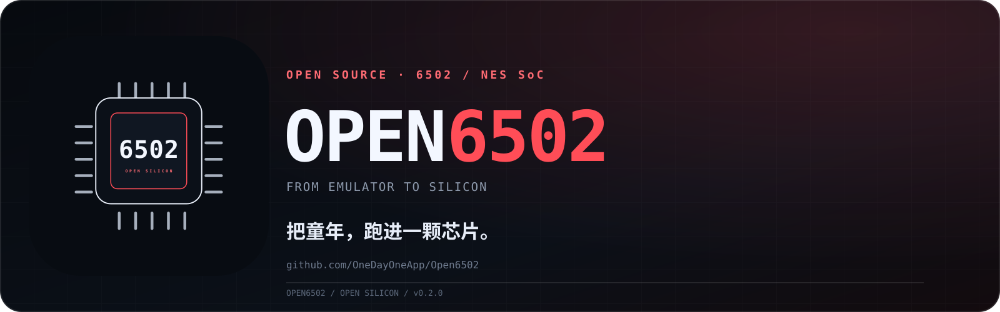
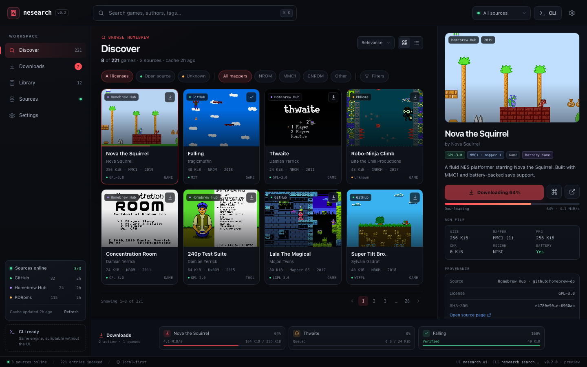

# Open6502

<p align="center">
  
</p>

**English** | [简体中文](README.zh-CN.md)

**A 6502/NES-compatible SoC that runs games in software today, and a
SystemVerilog chip design that renders the same game in RTL.**

Open6502 is two things in one repository:

- **`6502EMU`** — a NEMU-based 6502/NES emulator with a playable SDL frontend.
- **Open6502 RTL** — a SystemVerilog SoC with CPU, PPU, APU, bus, WRAM,
  cartridge mapper, DMA, controller input and VGA output.

The RTL is verified against the emulator: the CPU passes Klaus, and the RTL
title frame is byte-identical to the NEMU title frame.

## Website

- Project site: **[English (default)](https://onedayoneapp.github.io/Open6502/)** · **[中文](https://onedayoneapp.github.io/Open6502/index.zh.html)**
- Technical documentation: **[English (default)](https://onedayoneapp.github.io/Open6502/docs.html)** · **[中文](https://onedayoneapp.github.io/Open6502/docs.zh.html)**

The default pages select Chinese automatically when the primary OS/browser
locale is Chinese, and fall back to English. The bilingual static site lives
in [`site/`](site/) and is deployed by GitHub Pages.

## nesearch: NES search & download tool / NES 游戏搜索与下载工具

> **把童年，跑进一颗芯片。**  
> *Put childhood back into a chip.*

**English** — `nesearch` is a C++20 NES game discovery and download tool in this
repository, available as both a **CLI** and a **local Web UI**. It aggregates
GitHub homebrew catalogs, Homebrew Hub, PDRoms and Internet Archive, supports
custom JSON catalogs, and enriches entries with TuxNES mapper data and Fogleman
title screenshots. Downloads are resumable, SHA-256 verified and iNES-validated;
downloaded ROMs can be launched directly in **GEM6502** or **NEMU**.

**中文** — `nesearch` 是本仓库中的 C++20 NES 游戏搜索与下载工具，同时提供
**CLI** 和**本地 Web UI**。它聚合 GitHub homebrew 目录、Homebrew Hub、PDRoms
和 Internet Archive，支持自定义 JSON 目录，并使用 TuxNES mapper 数据与
Fogleman 标题截图补全元数据。下载支持断点续传、SHA-256 校验和 iNES 头校验，
下载后的 ROM 可直接用 **GEM6502** 或 **NEMU** 启动。



```sh
# Build / 构建
cmake -S nesearch -B nesearch/build \
  -DCMAKE_BUILD_TYPE=Release \
  -DCMAKE_CXX_COMPILER=/usr/bin/clang++
cmake --build nesearch/build -j

# Update catalog and start the UI / 更新目录并启动 UI
./nesearch/build/nesearch update
./nesearch/build/nesearch ui

# Or use the workspace-local launcher / 或使用 workspace 启动脚本
./nesearch/run-ui.sh
```

- Chinese documentation / 中文文档: [nesearch/README.md](nesearch/README.md)
- English documentation / 英文文档: [nesearch/README.en.md](nesearch/README.en.md)
- Screenshots / 截图: [nesearch/ui/screenshots](nesearch/ui/screenshots)

## Project goal: 55nm tapeout

The long-term goal is a **55nm tapeout** of an open, verifiable 6502/NES-compatible
SoC. The project follows a staged gate model:

```text
NEMU reference -> RTL SoC -> FPGA prototype -> 55nm ASIC tapeout
```

The repository is currently a functional prototype, not a tapeout-ready chip.

We are looking for technical contributors:

- 6502/NES hardware and verification reviewers
- PPU timing, sprite evaluation and APU/DMC engineers
- FPGA bring-up and timing-closure engineers
- 55nm ASIC, SRAM, DFT, PDK and physical-design engineers
- test-ROM and hardware-capture contributors with clear licenses

Start here:

- [55nm tapeout roadmap](docs/55nm-tapeout-roadmap.md)
- [Contributing guide](CONTRIBUTING.md)
- [Good first issues](CONTRIBUTING.md#good-first-issues)

## Progress summary

Last verified: **2026-11-11**. Percentages are engineering progress, not
tapeout completion.

| Stage | Progress | Evidence | Next gate |
|---|---:|---|---|
| NEMU reference | **90%** | Playable open-source games; CPU Klaus PASS; reference screenshots reproducible | Compatibility runs and replay goldens |
| RTL SoC | **60%** | 28 RTL tests PASS; RTL Klaus PASS at `PC=0x3469`; title frame byte-identical to NEMU; START gameplay frame rendered | Lockstep NEMU/RTL parity and cycle-accurate timing |
| FPGA prototype | **10%** | FPGA wrapper exists; no bitstream or board run | Full synthesis, BRAM, timing, board bring-up |
| 55nm ASIC | **5%** | Yosys area report and 55nm planning estimate | PDK, SRAM, DFT, timing, DRC/LVS, shuttle |

Current RTL metrics:

```text
RTL tests:            28 PASS
CPU Klaus:            PASS, PC=0x3469
RTL title frame:      SHA-256 41e8ebc137e3b8ede2f0adf915956fb9454346e9454e358c6dad2ee5a58f5a33
NEMU title frame:     same SHA-256
Yosys generic cells:  1,021,421
55nm planning die:    1.2-2.0 mm^2 after SRAM/PPU refactor
```

Main open blockers:

- PPU is not cycle-exact: no full fetch/shift pipeline or exact sprite evaluation.
- DMC bus arbitration and DMA alignment are incomplete.
- NEMU/RTL comparison is not yet a multi-game lockstep DiffTest.
- No FPGA bitstream and no silicon.

See [55nm tapeout roadmap](docs/55nm-tapeout-roadmap.md) for the full gate list.

---

## See it run

### RTL title screen


### RTL gameplay after START


### NEMU reference gameplay


---

## What works today

| Capability | Status |
|---|---|
| Play open-source NES games in `6502EMU` | **Yes** |
| RTL CPU passes Klaus | **Yes** |
| RTL renders `falling.nes` title | **Yes**, NEMU-identical |
| RTL enters gameplay after START | **Yes** |
| GEM6502 fast model runs `falling.nes` | **Yes** |
| RTL chiptune audio path | Partial |
| RTL FPGA bitstream | Not yet |
| Full NES game compatibility | Partial |

Bundled playable ROMs:

```text
falling          galaxypatrol     hanoi
table_tennis     file-fixers      stallar
```

All are open-source ROMs. See [roms/README.md](roms/README.md).

---

## Quick start: play now with NEMU

```sh
cd /Users/tongxiaojun/github/Open6502

# build once
cd NEMU
make m6502_defconfig
make -j8
cd ..

# play
./roms/play.sh falling
```

Or directly:

```sh
./NEMU/build/6502EMU roms/falling.nes
```

Keyboard:

| Key | Function |
|---|---|
| W/A/S/D | 1P direction |
| Space / Z | 1P A / jump |
| X | 1P B |
| C / V | 1P Select / Start |
| Esc | quit |

More ROMs, headless screenshots and replay options:
**[docs/game-testing.md](docs/game-testing.md)**.

---

## Quick start: run the RTL game

The RTL game runs in Verilator and writes a PPM frame.

```sh
cd /Users/tongxiaojun/github/Open6502

# 1. convert iNES to PRG/CHR binaries
python3 sim/game/extract_ines.py roms/falling.nes /tmp/falling falling

# 2. build the RTL model
rm -rf /tmp/obj_game
verilator --cc --exe -Wno-fatal --top-module open6502_top \
  -Mdir /tmp/obj_game \
  rtl/open6502_top.sv rtl/open6502_pkg.sv \
  rtl/cpu/open6502_cpu.sv rtl/bus/open6502_bus.sv rtl/bus/open6502_wram.sv \
  rtl/ppu/open6502_ppu.sv rtl/apu/open6502_apu.sv rtl/apu/open6502_dmc.sv \
  rtl/cart/open6502_mapper.sv rtl/clocks/open6502_clocks.sv \
  rtl/video/open6502_video_timing.sv rtl/input/open6502_controller.sv \
  rtl/dma/open6502_oam_dma.sv rtl/dbg/open6502_difftest_bridge.sv \
  sim/game/main.cpp

make -C /tmp/obj_game -f Vopen6502_top.mk \
  CXX=clang++ LINK=clang++ \
  CXXFLAGS='-isysroot /Library/Developer/CommandLineTools/SDKs/MacOSX.sdk' \
  LDFLAGS='-isysroot /Library/Developer/CommandLineTools/SDKs/MacOSX.sdk -L/opt/homebrew/Cellar/llvm/21.1.8/lib/c++' \
  LDLIBS='-lc++' -j2

# 3. run and capture a frame
/tmp/obj_game/Vopen6502_top \
  /tmp/falling/prg.bin /tmp/falling/chr.bin /tmp/falling-rtl.ppm
```

Convert to PNG:

```sh
python3 -c 'from PIL import Image; Image.open("/tmp/falling-rtl.ppm").save("/tmp/falling-rtl.png")'
```

Full RTL game-test guide:
**[docs/game-testing.md](docs/game-testing.md)**.

---

## Verification

```sh
cd rtl
make lint
make sim
```

Current results:

```text
28 RTL tests PASS
RTL Klaus PASS at PC=0x3469
```

NEMU/RTL co-simulation:

```sh
./sim/difftest/run.sh
./sim/difftest/run_alu.sh
```

Golden title frame:

```text
RTL  SHA-256 41e8ebc137e3b8ede2f0adf915956fb9454346e9454e358c6dad2ee5a58f5a33
NEMU SHA-256 41e8ebc137e3b8ede2f0adf915956fb9454346e9454e358c6dad2ee5a58f5a33
```

---

## Synthesis and manufacturing cost

Yosys per-module area:

| Block | Generic cells |
|---|---:|
| CPU | 4,138 |
| APU + DMC | 2,683 |
| Mapper | 745 |
| OAM DMA | 154 |
| WRAM | 37,003 |
| Bus/clock/video/controller | 779 |
| PPU | 975,919 |
| **Total** | **1,021,421** |

55nm planning estimate:

| Scenario | Die area |
|---|---:|
| Current RTL, memories as flip-flops | **4–7 mm²** |
| SRAM + PPU refactor | **1.2–2.0 mm²** |
| Recommended planning target | **~1.5 mm²** |

At volume, a 1.5–2.0 mm² die at 55nm is roughly:

```text
unit cost: USD 0.3-0.7 (die + package + test, planning estimate)
mask/NRE: USD 150k-400k+
```

Full area breakdown:
**[docs/open6502-chip/synthesis-area.md](docs/open6502-chip/synthesis-area.md)**

Cost model and assumptions:
**[docs/synthesis-and-cost.md](docs/synthesis-and-cost.md)**

---

## Repository map

```text
NEMU/                 NEMU-based 6502/NES emulator and BASIC
roms/                 Playable open-source NES ROMs
rtl/                  SystemVerilog SoC
  cpu/                Open6502 CPU
  ppu/                NES PPU
  apu/                APU and DMC
  bus/                Bus and WRAM
  cart/               Mapper 0/1/2/3/4/7
  dma/                OAM DMA
  input/              Controller
  video/              VGA timing
  fpga/               FPGA wrapper
tb/                   SystemVerilog testbenches
sim/difftest/         NEMU/RTL DiffTest
sim/game/             RTL game bring-up
GEM6502/              fast C cycle model for 6502/NES SoC
docs/                 Design, verification, area and cost documents
```

---

## Documentation

### Start here

- [Game testing: NEMU and RTL](docs/game-testing.md)
- [Synthesis and cost](docs/synthesis-and-cost.md)

### Chip design

- [Chip overview](docs/open6502-chip/README.md)
- [Architecture](docs/open6502-chip/architecture.md)
- [Verification](docs/open6502-chip/verification.md)
- [DiffTest](docs/open6502-chip/difftest.md)
- [Checklist](docs/open6502-chip/checklist.md)
- [Synthesis area](docs/open6502-chip/synthesis-area.md)
- [START recovery plan](docs/open6502-chip/startup-recovery-plan.md)

### Models and reference

- [GEM6502 fast C cycle model](GEM6502/README.md)
- [6502EMU guide](NEMU/6502EMU.md)
- [NES golden reference design](docs/nes-golden-reference/design.md)
- [NES golden reference test plan](docs/nes-golden-reference/test-plan.md)

---

## Brand assets

- [Logo mark (SVG)](docs/images/logo.svg)
- [Logo mark (PNG, 1024×1024)](docs/images/logo.png)
- [Logo lockup (SVG)](docs/images/logo-lockup.svg)
- [Logo lockup (PNG)](docs/images/logo-lockup.png)
- [GitHub social preview (1280×640)](docs/images/logo-social.png)

---

## Current limitations

- RTL PPU is functional but not cycle-exact.
- Sprite evaluation and MMC3 A12 timing are approximate.
- DMC bus arbitration and CPU DMA alignment are incomplete.
- RTL frame capture is Verilator-based; there is no SDL frontend for RTL yet.
- No FPGA bitstream or board validation yet.
- Full flattened synthesis and timing closure are not complete.

---

## License

- **Open6502 code** — `rtl/`, `sim/`, `tb/`, `GEM6502/`, `nesearch/`, `site/`,
  `docs/` and the repository scripts are released under the
  [MIT License](LICENSE), © 2026 OneDayOneApp.
- **`NEMU/`** is a fork of [NJU-ProjectN/nemu](https://github.com/NJU-ProjectN/nemu)
  and stays under [Mulan PSL v2](NEMU/LICENSE); the 6502 ISA port and the NES
  frontend follow the same license. See [NEMU/NOTICE](NEMU/NOTICE).
- **Bundled ROMs** are MIT licensed; per-ROM texts are in
  [roms/LICENSES](roms/LICENSES) (the site copy ships the same texts under
  `site/assets/play/roms/LICENSES/`).
- **Third-party components** (SDL2, libcurl, nlohmann/json, cpp-httplib,
  msbasic, the GPL kconfig and qemu-diff build tools) and the readline/GPL
  caveat for Linux binaries are documented in
  [THIRD_PARTY_NOTICES.md](THIRD_PARTY_NOTICES.md).
