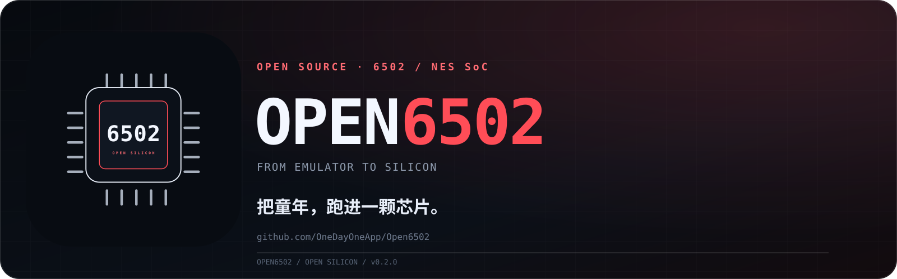
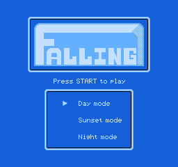
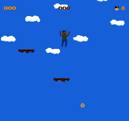
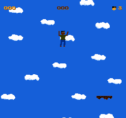

# Open6502

<p align="center">
  
</p>

[English](README.md) | **简体中文**

**一个今天就能在软件里玩 NES 游戏，同时又能用 SystemVerilog RTL 渲染同一款游戏的 6502/NES SoC 项目。**

Open6502 在同一个仓库里包含两部分：

- **`6502EMU`**：基于 NEMU 的 6502/NES 模拟器，带可玩的 SDL 前端。
- **Open6502 RTL**：SystemVerilog SoC，包含 CPU、PPU、APU、总线、WRAM、卡带 mapper、DMA、手柄输入和 VGA 输出。

RTL 与模拟器互相验证：CPU 通过 Klaus，RTL 标题帧与 NEMU 标题帧逐字节一致。

## 项目网站

- 项目主页：**https://onedayoneapp.github.io/Open6502/**
- 技术文档：**https://onedayoneapp.github.io/Open6502/docs.html**

静态站点源码在 [`site/`](site/)，由 GitHub Pages 自动发布。

## 项目目标：55nm 流片

长期目标是完成一颗**开放、可验证的 6502/NES 兼容 SoC 的 55nm 流片**。
项目采用分阶段门禁模型：

```text
NEMU 参考模型 -> RTL SoC -> FPGA 原型 -> 55nm ASIC 流片
```

当前仓库是功能原型，还不是 tapeout-ready 芯片。

正在寻找技术爱好者一起参与：

- 6502/NES 硬件与验证评审
- PPU 时序、精灵 evaluation、APU/DMC 工程师
- FPGA bring-up 与时序收敛工程师
- 55nm ASIC、SRAM、DFT、PDK、物理设计工程师
- 能提供明确许可证的测试 ROM 和硬件采集数据

从这里开始：

- [55nm 流片路线图](docs/55nm-tapeout-roadmap.md)
- [贡献指南](CONTRIBUTING.md)
- [适合新手的任务](CONTRIBUTING.md#good-first-issues)

## 进度概要

最后验证：**2026-11-11**。百分比是工程进度，不是流片完成度。

| 阶段 | 进度 | 依据 | 下一道门禁 |
|---|---:|---|---|
| NEMU 参考模型 | **90%** | 开源游戏可玩；CPU Klaus PASS；参考截图可复现 | 兼容性回归和回放 golden |
| RTL SoC | **60%** | 28 个 RTL 测试 PASS；RTL Klaus PASS at `PC=0x3469`；标题帧与 NEMU 逐字节一致；START 后游戏帧可渲染 | NEMU/RTL lockstep 对齐与逐周期时序 |
| FPGA 原型 | **10%** | 有 FPGA 顶层封装；无 bitstream 和板级运行 | 全综合、BRAM、时序、上板 |
| 55nm ASIC | **5%** | 有 Yosys 面积报告和 55nm 规划估算 | PDK、SRAM、DFT、时序、DRC/LVS、shuttle |

当前 RTL 指标：

```text
RTL 测试：            28 PASS
CPU Klaus：           PASS, PC=0x3469
RTL 标题帧：          SHA-256 41e8ebc137e3b8ede2f0adf915956fb9454346e9454e358c6dad2ee5a58f5a33
NEMU 标题帧：         相同 SHA-256
Yosys generic cells： 1,021,421
55nm 规划 die：        SRAM/PPU 重构后 1.2-2.0 mm²
```

当前主要未完成项：

- PPU 不是逐周期精确：还没有完整 fetch/shift 流水线和精确精灵 evaluation。
- DMC 总线仲裁和 DMA 对齐未完成。
- NEMU/RTL 对比还不是多游戏 lockstep DiffTest。
- 没有 FPGA bitstream，也没有硅片。

完整门禁列表见 [55nm 流片路线图](docs/55nm-tapeout-roadmap.md)。

---

## 先看效果

### RTL 标题画面



### RTL 按 START 后的游戏画面



### NEMU 参考游戏画面



---

## 现在能做什么

| 能力 | 状态 |
|---|---|
| 用 `6502EMU` 玩开源 NES 游戏 | **可以** |
| RTL CPU 通过 Klaus | **通过** |
| RTL 渲染 `falling.nes` 标题 | **可以**，与 NEMU 一致 |
| RTL 按 START 进入游戏 | **可以** |
| GEM6502 快速模型运行 `falling.nes` | **可以** |
| RTL 音频链路 | 部分 |
| RTL FPGA bitstream | 尚未 |
| 完整 NES 游戏兼容 | 部分 |

仓库内置可玩 ROM：

```text
falling          galaxypatrol     hanoi
table_tennis     file-fixers      stallar
```

均为开源 ROM，许可证见 [roms/LICENSES](roms/LICENSES)。

---

## 快速开始：用 NEMU 玩

```sh
cd /Users/tongxiaojun/github/Open6502

# 首次构建
cd NEMU
make m6502_defconfig
make -j8
cd ..

# 开始游戏
./roms/play.sh falling
```

也可以直接运行：

```sh
./NEMU/build/6502EMU roms/falling.nes
```

键盘：

| 按键 | 功能 |
|---|---|
| W/A/S/D | 1P 方向 |
| Space / Z | 1P A / 跳跃 |
| X | 1P B |
| C / V | 1P Select / Start |
| Esc | 退出 |

更多 ROM、无窗口截图和回放参数见：
**[docs/game-testing.md](docs/game-testing.md)**。

---

## 快速开始：运行 RTL 游戏

RTL 游戏通过 Verilator 运行，并输出 PPM 帧。

```sh
cd /Users/tongxiaojun/github/Open6502

# 1. 提取 iNES 的 PRG/CHR
python3 sim/game/extract_ines.py roms/falling.nes /tmp/falling falling

# 2. 构建 RTL 模型
rm -rf /tmp/obj_game
verilator --cc --exe -Wno-fatal --top-module open6502_top \
  -Mdir /tmp/obj_game \
  rtl/open6502_top.sv rtl/open6502_pkg.sv \
  rtl/cpu/open6502_cpu.sv rtl/bus/open6502_bus.sv rtl/bus/open6502_wram.sv \
  rtl/ppu/open6502_ppu.sv rtl/apu/open6502_apu.sv rtl/apu/open6502_dmc.sv \
  rtl/cart/open6502_mapper.sv rtl/clocks/open6502_clocks.sv \
  rtl/video/open6502_video_timing.sv rtl/input/open6502_controller.sv \
  rtl/dma/open6502_oam_dma.sv rtl/dbg/open6502_difftest_bridge.sv \
  sim/game/main.cpp

make -C /tmp/obj_game -f Vopen6502_top.mk \
  CXX=clang++ LINK=clang++ \
  CXXFLAGS='-isysroot /Library/Developer/CommandLineTools/SDKs/MacOSX.sdk' \
  LDFLAGS='-isysroot /Library/Developer/CommandLineTools/SDKs/MacOSX.sdk -L/opt/homebrew/Cellar/llvm/21.1.8/lib/c++' \
  LDLIBS='-lc++' -j2

# 3. 运行并抓取一帧
/tmp/obj_game/Vopen6502_top \
  /tmp/falling/prg.bin /tmp/falling/chr.bin /tmp/falling-rtl.ppm
```

转成 PNG：

```sh
python3 -c 'from PIL import Image; Image.open("/tmp/falling-rtl.ppm").save("/tmp/falling-rtl.png")'
```

完整 RTL 游戏测试说明：
**[docs/game-testing.md](docs/game-testing.md)**。

---

## 验证结果

```sh
cd rtl
make lint
make sim
```

当前结果：

```text
28 个 RTL 测试 PASS
RTL Klaus PASS at PC=0x3469
```

NEMU/RTL 联合验证：

```sh
./sim/difftest/run.sh
./sim/difftest/run_alu.sh
```

标题帧 golden：

```text
RTL  SHA-256 41e8ebc137e3b8ede2f0adf915956fb9454346e9454e358c6dad2ee5a58f5a33
NEMU SHA-256 41e8ebc137e3b8ede2f0adf915956fb9454346e9454e358c6dad2ee5a58f5a33
```

---

## 综合与制造成本

Yosys 分模块面积：

| 模块 | Generic cells |
|---|---:|
| CPU | 4,138 |
| APU + DMC | 2,683 |
| Mapper | 745 |
| OAM DMA | 154 |
| WRAM | 37,003 |
| Bus/clock/video/controller | 779 |
| PPU | 975,919 |
| **合计** | **1,021,421** |

55nm 规划估算：

| 场景 | Die 面积 |
|---|---:|
| 当前 RTL，显存用触发器实现 | **4–7 mm²** |
| SRAM + PPU 重构后 | **1.2–2.0 mm²** |
| 推荐规划目标 | **约 1.5 mm²** |

按 1.5–2.0 mm²、55nm 估算：

```text
单位成本：约 USD 0.3–0.7（die + 封装 + 测试，规划估算）
Mask/NRE：约 USD 150k–400k+
```

完整面积拆分：
**[docs/open6502-chip/synthesis-area.md](docs/open6502-chip/synthesis-area.md)**

成本模型和假设：
**[docs/synthesis-and-cost.md](docs/synthesis-and-cost.md)**

---

## 仓库结构

```text
NEMU/                 NEMU 6502/NES 模拟器与 BASIC
roms/                 可玩的开源 NES ROM
rtl/                  SystemVerilog SoC
  cpu/                Open6502 CPU
  ppu/                NES PPU
  apu/                APU 与 DMC
  bus/                总线与 WRAM
  cart/               Mapper 0/1/2/3/4/7
  dma/                OAM DMA
  input/              手柄
  video/              VGA 时序
  fpga/               FPGA 顶层
tb/                   SystemVerilog 测试平台
sim/difftest/         NEMU/RTL DiffTest
sim/game/             RTL 游戏 bring-up
GEM6502/              6502/NES SoC 的快速 C 周期模型
docs/                 设计、验证、面积与成本文档
```

---

## 文档索引

### 从这里开始

- [游戏测试：NEMU 与 RTL](docs/game-testing.md)
- [综合与成本](docs/synthesis-and-cost.md)

### 芯片设计

- [芯片概览](docs/open6502-chip/README.md)
- [架构](docs/open6502-chip/architecture.md)
- [验证](docs/open6502-chip/verification.md)
- [DiffTest](docs/open6502-chip/difftest.md)
- [检查清单](docs/open6502-chip/checklist.md)
- [综合面积](docs/open6502-chip/synthesis-area.md)
- [START 恢复计划](docs/open6502-chip/startup-recovery-plan.md)

### 模型与参考

- [GEM6502 快速 C 周期模型](GEM6502/README.md)
- [6502EMU 指南](NEMU/6502EMU.md)
- [NES golden reference 设计](docs/nes-golden-reference/design.md)
- [NES golden reference 测试计划](docs/nes-golden-reference/test-plan.md)

---

## 品牌资源

- [Logo 图标（SVG）](docs/images/logo.svg)
- [Logo 图标（PNG，1024×1024）](docs/images/logo.png)
- [Logo 横版（SVG）](docs/images/logo-lockup.svg)
- [Logo 横版（PNG）](docs/images/logo-lockup.png)
- [GitHub 社交预览图（1280×640）](docs/images/logo-social.png)

## 当前限制

- RTL PPU 功能可用，但不是逐周期精确。
- 精灵 evaluation 和 MMC3 A12 时序仍是近似。
- DMC 总线仲裁和 CPU DMA 对齐尚不完整。
- RTL 帧输出基于 Verilator，RTL 还没有 SDL 前端。
- 还没有 FPGA bitstream 和板级验证。
- 完整 flatten 综合和时序收敛尚未完成。

---

## 第三方许可证

内置 ROM 的许可证见 [roms/LICENSES](roms/LICENSES)。

仓库暂未声明根项目许可证，再分发前需要补充。
