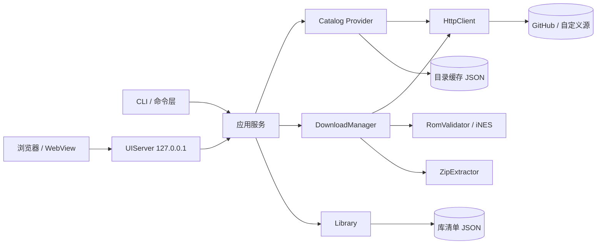
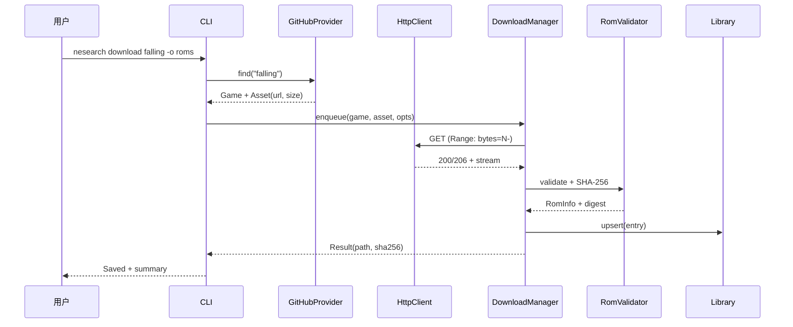

# nesearch 产品需求文档（PRD）

> **一句话定义**：`nesearch` 是一个用 C++20 编写的命令行工具，用于搜索、下载、校验和登记可自由分发的 NES / homebrew 游戏 ROM。

| 项目 | 内容 |
|---|---|
| 产品名称 | nesearch（NES + Search） |
| 文档版本 | v0.2（草案） |
| 文档日期 | 2026-11-11 |
| 文档状态 | 待评审 |
| 实现语言 | C++20 |
| 目标平台 | macOS 13+、Linux（glibc 2.31+）；Windows 10+ 为 P1 |
| 关联项目 | Open6502 / 6502EMU |
| 代码位置 | `nesearch/` |
| 许可 | 代码建议 MIT；ROM 遵循各自许可证 |

> **实现状态（2026-11-12）**：CLI 搜索/下载/校验/库、GitHub + Homebrew Hub + PDRoms RSS 三个内置目录、Internet Archive Provider（当前网络 offline）、TuxNES Mapper / Fogleman 标题截图元数据源、自定义 JSON 源、本地 Web UI（实时 API）、GEM6502/NEMU 启动、Library Grid/List 已可运行；itch.io、PDRoms 全量目录、SSE、Windows 打包仍待实现。

---

## 0. 摘要（TL;DR）

- **解决什么问题**：Open6502 的回归测试需要持续获取合法的 NES ROM；目前 `roms/` 里的 6 个开源游戏靠手工搜集、下载、校验和登记，效率低且难以复现。
- **产品形态**：单二进制，**CLI + 本地 UI 双模式**；UI 通过 loopback 服务在浏览器/WebView 中打开，不依赖远程服务。
- **默认数据源**：GitHub 仓库 [`retrobrews/nes-games`](https://github.com/retrobrews/nes-games)，当前含 **82 个 homebrew ROM**（6,366,496 字节，约 6.1 MiB），每个 ROM 配同名 `.txt` 元数据；仓库可访问、无需 API Token 即可下载。
- **核心命令**：`update`、`search`、`info`、`download`、`list`、`verify`。
- **关键能力**：本地索引缓存、断点续传、SHA-256 + iNES 头校验、原子落盘、JSON/NDJSON 输出、可配置代理。
- **明确不做**：内置商业 ROM 索引、模拟器、ROM 修改/补丁、模拟器前端、BT 下载、NSF/BIOS、绕过授权或付费墙。

---

## 1. 背景与目标

### 1.1 背景

Open6502 是一个 6502/NES 兼容 SoC 项目，仓库内的 `6502EMU` 和 RTL 验证依赖一批可合法分发的 NES ROM。现有 [`roms/README.md`](../roms/README.md) 手工维护了 6 个开源游戏，每个都需要：

1. 找到项目主页或发布页；
2. 下载 `.nes` 文件；
3. 核对许可证并复制到 `roms/LICENSES/`；
4. 重命名、记录来源、验证文件有效；
5. 在模拟器中跑 300 帧确认可启动。

这套流程对贡献者不友好，也不适合 CI 自动拉取回归 ROM。`nesearch` 把“发现 → 下载 → 校验 → 登记”收敛为一条命令。

### 1.2 产品定位

`nesearch` 是一个**面向 NES 开发者与 homebrew 玩家的 CLI + 本地 UI ROM 获取工具**，不是 ROM 站点镜像，也不是模拟器前端。

三个典型价值：

- **对 Open6502 贡献者**：一条命令拿到一批合法测试 ROM，并写入可追溯的清单。
- **对 NES 玩家**：用关键词发现 homebrew 游戏，看到作者、大小、mapper、许可证后再决定下载。
- **对自动化/CI**：稳定的 JSON 输出、明确退出码、可缓存、可离线、可指定自定义目录。

### 1.3 设计原则

1. **合法优先**：内置数据源只收录公开分发的 homebrew / 开源游戏；不内置商业 ROM 索引。
2. **可验证**：每个下载文件都做格式与完整性校验；清单记录来源 URL 与 SHA-256。
3. **可恢复**：断点续传、指数退避重试、原子重命名，绝不把半文件当成完整 ROM。
4. **可脚本化**：`--json` / NDJSON、稳定退出码、非 TTY 友好、无交互提示阻塞。
5. **少依赖**：核心只依赖 libcurl；JSON、CLI 解析、Zip、测试框架均以单文件 vendor，支持离线构建。
6. **可移植**：macOS / Linux 优先，Windows 留好抽象层。
7. **双模一致**：CLI 与 UI 共用同一核心与配置；UI 只做展示/交互，所有动作可映射为 CLI 命令。

### 1.4 成功指标

| 指标 | 目标 | 测量方式 |
|---|---|---|
| 首次搜索可用时间 | ≤ 10 s（含索引拉取） | 默认网络、82 条目录 |
| 热缓存搜索延迟 | p95 ≤ 50 ms | 本地基准测试 |
| 默认目录下载成功率 | ≥ 99%（网络正常） | 集成测试 + 手动抽查 |
| 断点续传正确率 | 100% | 本地 Range 测试服务器 |
| 半文件入库数 | 0 | 校验测试 |
| 干净环境构建时间 | ≤ 2 min | CI 计时 |
| 核心模块单测覆盖 | ≥ 70%（P1） | gcov / llvm-cov |

---

## 2. 用户与使用场景

### 2.1 用户画像

| 用户 | 特征 | 核心诉求 |
|---|---|---|
| Open6502 贡献者 | 熟悉命令行与 C++，需要测试 ROM | 批量获取、可复现、许可证清晰 |
| NES homebrew 玩家 | 知道游戏名，想快速下载 | 搜索准确、下载快、能看到截图/作者 |
| CI / 自动化脚本 | 无交互环境 | JSON 输出、退出码、缓存、超时控制 |
| 离线/弱网用户 | 代理或镜像环境 | 可配置代理、可复用缓存、可断点续传 |

### 2.2 用户故事

| ID | 故事 | 验收要点 |
|---|---|---|
| US-01 | 作为 Open6502 开发者，我想用关键词找到游戏并下载到 `roms/`，以便快速做兼容性测试。 | `nesearch download falling -o roms` 成功，文件可被 6502EMU 加载。 |
| US-02 | 作为玩家，我想先看游戏详情（作者、大小、mapper、许可证）再下载。 | `info` 展示字段完整；`--deep` 能取到描述与许可证。 |
| US-03 | 作为 CI，我想让程序在失败时返回稳定退出码，并输出机器可读结果。 | `--json` 输出可解析；网络/校验/未找到退出码可区分。 |
| US-04 | 作为弱网用户，我想中断后继续下载，而不是从头开始。 | 保留 `.part`，重跑从断点续传；服务端不支持 Range 时安全重下。 |
| US-05 | 作为合规审查者，我想知道 ROM 的来源和许可证。 | 清单与 `info` 记录 source URL、license、tree SHA、下载时间。 |

---

## 3. 范围与优先级

优先级定义：**P0 = v0.1 必须（发布阻塞）；P1 = v0.1 目标（可顺延到 v0.1.x，不阻塞首发）；P2 = v0.2 及以后**。

### 3.1 v0.1 范围

P0（必须）：

- 默认 GitHub 目录的拉取、缓存与关键词搜索。
- 游戏详情（基础字段 + `--deep` 元数据）。
- 单文件/多文件下载，断点续传，重试，原子落盘。
- SHA-256 计算、iNES/NES 2.0 头解析、基本完整性校验。
- 本地库清单（`list`、`verify`）。
- JSON/NDJSON 输出与稳定退出码。
- 配置文件、环境变量、代理、可选 GitHub Token。
- macOS / Linux 构建与测试；GitHub Actions CI。

P1（目标，可顺延到 v0.1.x）：

- Zip 包内 `.nes` 提取（为 GitHub Releases 类数据源做准备；防 Zip Slip）。
- 并发下载与进度条（默认 4 并发，可 `--jobs` 调整）。
- 自定义 JSON 目录（团队镜像、CI 固定版本、内部 vetted 列表）。
- Windows 10+ 支持（MSVC + vcpkg，路径/终端适配）。

### 3.2 后续版本范围（P2）

| 优先级 | 功能 | 说明 |
|---|---|---|
| P2 | GitHub Releases 自动发现 | 按 topic/keyword 搜仓库，取 release 中的 `.nes` |
| P2 | Internet Archive 数据源 | advancedsearch + metadata + download；需代理时可用 |
| P2 | 与 6502EMU / `play.sh` 集成 | 下载后直接启动游戏 |
| P2 | DAT / No-Intro 校验 | 按 CRC32/SHA-1 匹配 ROM 数据库 |
| P2 | 中文界面 / i18n | CLI 默认英文，文档中文 |

UI 模式作为 **v0.2** 独立交付（见 [UI_DESIGN.md](UI_DESIGN.md)），不阻塞 v0.1 CLI；两者共用核心。v0.2 同时交付 Sources 页“添加自定义 JSON 源”与 HTTP 访问地址。

### 3.3 非目标

- 内置源不提供商业 ROM 索引；自定义源由用户配置，UI 不按许可证过滤结果。
- 不做 NES 模拟器、PPU/APU 调试器或模拟器前端（UI 只负责搜索/下载/库管理）。
- 不做 ROM Hack、补丁、汉化、金手指。
- 不做 BT/磁力链、网盘转存、验证码绕过。
- 不抓取没有公开 API 且 ToS 禁止抓取的站点。
- 不内置 ROM 文件本身；仓库只包含代码、测试用合成数据。

---

## 4. 功能需求

### 4.1 需求总表

| ID | 需求 | 优先级 | 说明 |
|---|---|---|---|
| FR-01 | 目录更新与缓存 | P0 | `update` 拉取目录，TTL 内复用缓存 |
| FR-02 | 关键词搜索 | P0 | 匹配 ID/标题/作者/描述，支持排序与分页 |
| FR-03 | 游戏详情 | P0 | 基础字段 + `--deep` 远程元数据 |
| FR-04 | 下载 | P0 | 单/多 ID，输出目录，跳过已存在 |
| FR-05 | 断点续传与重试 | P0 | Range、退避、超时、可恢复 |
| FR-06 | 完整性校验 | P0 | SHA-256、大小、iNES 头 |
| FR-07 | 本地库管理 | P0 | `list`、`verify`、缺失文件标记 |
| FR-08 | 机器可读输出 | P0 | `--json`、NDJSON 事件、稳定 schema |
| FR-09 | 配置管理 | P0 | 文件/环境变量/命令行优先级 |
| FR-10 | 自定义 JSON 目录 | P1 | 本地或 HTTPS URL |
| FR-11 | 并发下载 | P1 | 线程池，默认 4，上限 16 |
| FR-12 | Zip 解压 | P1 | 单个 `.nes`，路径安全 |
| FR-13 | GitHub Releases 发现 | P2 | 搜索 + release assets |
| FR-14 | Internet Archive 源 | P2 | 可配置 collection |
| FR-15 | 模拟器启动集成 | P2 | 调用 6502EMU / `play.sh` |
| FR-16 | 国际化 | P2 | 英文默认，中文可选 |

### 4.2 命令总览

```text
nesearch <command> [options]

命令：
  update       刷新并缓存游戏目录
  search       搜索游戏
  info         查看游戏详情
  download     下载一个或多个游戏
  list         列出本地库
  verify       校验本地 ROM 的哈希与格式
  config       查看配置路径与生效配置
  sources      查看数据源与缓存状态
  help         显示帮助
```

全局选项：

| 选项 | 说明 |
|---|---|
| `-h, --help` | 帮助 |
| `-V, --version` | 版本号（语义化版本 + git describe） |
| `-v, --verbose` | 调试日志到 stderr（不打印 Token） |
| `-q, --quiet` | 仅错误输出 |
| `--json` | 机器可读输出；stdout 只放数据 |
| `--no-color` | 禁用 ANSI 颜色；非 TTY 自动禁用 |
| `--config PATH` | 指定配置文件 |
| `--offline` | 只使用缓存，不发起网络请求 |
| `--timeout SEC` | 连接/低速超时覆盖 |
| `--proxy URL` | 覆盖代理设置 |
| `--provider NAME` | 数据源：`github`（默认）/ `json`（P1）/ `archive`（P2） |
| `--catalog PATH_OR_URL` | 自定义 JSON 目录位置（`--provider json` 时） |

### 4.3 `update`：目录更新

```text
nesearch update [--force] [--no-metadata] [--json]
```

行为：

1. 读取缓存；若 `fetched_at` 在 TTL（默认 24 h）内且未 `--force`，直接返回，输出“cache is fresh”。
2. 条件请求目录树（ETag / If-None-Match）。304 时复用缓存。
3. 解析 `.nes` 文件列表，生成稳定 ID。
4. 默认并发拉取每个 ROM 的 `.txt` 元数据（最多 4 并发，ETag 缓存）；`--no-metadata` 跳过，仅保留文件名与 README 信息。
5. 合并 README 中的标题/作者作为兜底。
6. 原子写入缓存（临时文件 + rename），记录 `tree_sha`、`fetched_at`、各请求 ETag。
7. 输出统计：总数、新增、更新、元数据失败数。

失败策略：

- 目录树请求失败且无缓存 → 退出码 3，提示网络/代理/`--offline`。
- 有旧缓存 → 使用旧缓存并警告（stale），退出码 0。
- 单个元数据失败 → 保留旧值或标记 `unknown`，不阻塞整体更新；失败超过 50% 时给出警告。
- 403/429：识别 GitHub 速率限制，提示设置 `GITHUB_TOKEN`，输出重置时间，退出码 9。

### 4.4 `search`：搜索

```text
nesearch search <query> [--all] [--limit N] [--offset N]
                         [--sort relevance|title|size|id] [--refresh] [--json]
```

语义：

- 查询按空白切分，全部 token 需命中（AND）。
- 匹配字段：`id`、`title`、`author`、`description`、`license`。
- 大小写不敏感；ASCII 折叠变音符号（`Bootèe` → `bootee`）。
- 空查询必须搭配 `--all`，否则报用法错误。
- `--limit` 默认 20，范围 1–500；`--offset` 默认 0。
- 默认排序：精确 ID > 标题前缀 > 标题包含 > 作者 > 描述，同分按标题字典序。
- `--refresh`：先执行 `update`（受 TTL 约束），再搜索。
- 无结果：stdout 输出提示，退出码 0（脚本可读 `count: 0`）。

输出（表格，非 TTY 时每行一条）：

```text
$ nesearch search falling
ID       TITLE    AUTHOR        SIZE     MAPPER  LICENSE
falling  Falling  tragicmuffin  40.0 KiB  0 (NROM) MIT
1 result (catalog: github:retrobrews/nes-games, updated 2026-11-11 20:00)
```

说明：`MAPPER` 在未下载时可能为空（目录不提供 ROM 头信息），下载后可从本地文件解析；表格中显示 `-`。

### 4.5 `info`：详情

```text
nesearch info <id> [--deep] [--json]
```

展示字段：

| 字段 | 来源 | 说明 |
|---|---|---|
| ID | 目录 | 稳定标识 |
| Title | 元数据/文件名 | 游戏名 |
| Author | 元数据 | 作者/团队 |
| Size | 目录树/HEAD | 字节数，人类可读 |
| License | `.txt` 检测 | 未知显示 `unknown` |
| Source | 配置 | `github:retrobrews/nes-games` |
| Page | `.txt` 中的 URL | 项目主页 |
| Description | `.txt` | 截断到 500 字符，`--json` 给全文 |
| ROM | 本地文件（若已下载） | iNES 版本、mapper、PRG/CHR、mirroring、battery |
| Local | 清单 | 路径、SHA-256、下载时间 |
| Metadata | 缓存 | `meta_fetched_at` / stale 标记 |

- `--deep`：对该条目发起 ETag 条件请求刷新元数据（304 时复用），失败时回退缓存并警告。
- 未下载时 `ROM` 显示 `-`；`info` 不触发下载。

### 4.6 `download`：下载

```text
nesearch download <id>... [-o DIR] [--jobs N] [--force]
                            [--no-verify] [--fail-fast] [--json]
```

流程：

1. 解析 ID；不存在则列出相近 ID（编辑距离 ≤ 2），退出码 4。
2. 选择资源：优先 `.nes`；若只有 `.zip`（P1）则下载后提取单个 `.nes`。
3. 目标路径：`<output>/<id>.nes`；`output` 默认 `~/Downloads/nesearch`，可用 `-o/--output` 覆盖。
4. 若目标已存在：
   - 文件有效（iNES 头 + 大小合理）→ 默认跳过（若清单缺失则补登记），除非 `--force`；
   - 文件无效 → 报错并提示 `--force`（避免静默覆盖用户文件）。
5. 若 `<id>.nes.part` 存在且 `--force` 未设置 → 尝试 Range 续传。
6. 流式下载（64 KiB 缓冲），每 100 ms 更新进度；校验 Content-Length（若有）。
7. 下载完成后：
   - 始终流式计算 SHA-256 并写入清单；
   - 若资源带 SHA-256 且启用校验 → 严格比对，不一致则失败；
   - 解析 iNES 头，校验 magic、PRG/CHR 长度；校验失败则不落盘为 `.nes`；
   - `--no-verify` 仅跳过“严格比对/拒绝”逻辑（清单标记 `verified:false`），不跳过大小、路径与 TLS 检查；
   - `fsync` 后原子 rename 为最终文件（Windows 先删除旧文件再 rename）。
8. 写入本地库清单（文件锁保护），记录来源与元数据。
9. 输出结果；批量模式下逐项汇总。

命名与路径安全：

- 文件名只使用合法 ID：`[a-z0-9][a-z0-9-]{0,63}`。
- 最终路径必须位于 `output` 目录内（`weakly_canonical` 检查）。
- 拒绝 `.exe`、`.bat` 等可执行扩展；默认只接受 `.nes` / `.zip`。

断点续传：

- 请求头 `Range: bytes=<part_size>-`。
- 206 → 追加写；200 → 服务端忽略 Range，截断重下；416 → 校验已下载大小后决定完成或重下。
- 续传前检查 `.part` 大小不超过已知总大小；超出则丢弃。
- 中断（Ctrl-C / SIGTERM）→ 停止新任务、中止传输、保留 `.part`，退出码 7；第二次 Ctrl-C 强制退出。

重试：

- 针对连接失败、超时、429、5xx，最多 3 次，指数退避 1 s / 2 s / 4 s + 抖动。
- 尊重 `Retry-After`（上限 30 s）。
- 404/403 不重试；403 若为速率限制则按 429 处理。

并发：

- 默认 `min(4, hardware_concurrency)`，`--jobs` 范围 1–16。
- 每个下载持有独立 curl easy handle；全局只初始化一次 libcurl。
- 同一 ID 不允许并发重复下载（进程内互斥 + 目标文件锁）。

JSON 模式输出 NDJSON 事件：

```json
{"event":"start","id":"falling","url":"https://raw.githubusercontent.com/..."}
{"event":"progress","id":"falling","received":20480,"total":40976}
{"event":"complete","id":"falling","path":"/Users/me/Downloads/nesearch/falling.nes","size":40976,"sha256":"<64-hex>"}
{"event":"error","id":"broken","code":5,"message":"invalid iNES header"}
{"event":"summary","total":2,"ok":1,"failed":1}
```

### 4.7 `list` 与 `verify`

```text
nesearch list [--json] [--verify]
nesearch verify [<id>...] [--all] [--json]
```

- `list` 读取本地库清单，显示 ID、文件路径、大小、mapper、下载时间；文件缺失标记 `missing`。
- `--verify` 对每个条目重算 SHA-256 并解析头，标记 `ok` / `modified` / `corrupt` / `missing`。
- `verify` 是 `list --verify` 的严格版本，校验失败退出码 5。
- 不自动删除文件；`--prune` 仅清理清单中缺失的条目（P2）。

### 4.8 配置

```text
nesearch config [show|path|init] [--json]
```

- `show`：打印生效配置（Token 永远不显示）。
- `path`：打印配置文件、缓存、库清单路径。
- `init`：生成默认配置文件（字段说明见 README；已存在则不覆盖，退出码 6）。

加载优先级：**命令行 > 环境变量 > 配置文件 > 内置默认值**。

配置文件（JSON，UTF-8）：

```json
{
  "schema": 1,
  "provider": "github",
  "github": {
    "repo": "retrobrews/nes-games",
    "ref": "master",
    "api_base": "https://api.github.com",
    "raw_base": "https://raw.githubusercontent.com",
    "fetch_metadata": true
  },
  "download": {
    "dir": "~/Downloads/nesearch",
    "jobs": 4,
    "max_bytes": 67108864,
    "resume": true,
    "verify": true
  },
  "http": {
    "proxy": "",
    "connect_timeout_seconds": 10,
    "low_speed_limit_bytes": 1024,
    "low_speed_time_seconds": 30,
    "retries": 3,
    "user_agent": "nesearch/0.1.0"
  },
  "cache": {
    "ttl_hours": 24
  },
  "output": {
    "color": "auto"
  }
}
```

环境变量：

| 变量 | 说明 |
|---|---|
| `NESEARCH_CONFIG` | 配置文件路径 |
| `NESEARCH_CACHE_DIR` | 缓存目录 |
| `NESEARCH_DOWNLOAD_DIR` | 默认下载目录 |
| `NESEARCH_PROXY` / `HTTPS_PROXY` | 代理 |
| `GITHUB_TOKEN` | 可选，仅用于 `api.github.com` 请求 |
| `NO_COLOR` | 禁用颜色 |

### 4.9 `sources`：数据源状态

```text
nesearch sources [--json]
```

显示当前 provider、仓库/引用、缓存文件路径、缓存年龄、条目数、是否 stale、最近一次错误（若有）。用于排查“为什么搜不到”和确认离线缓存是否可用。

### 4.10 输出与退出码契约

- stdout：命令结果（表格、JSON、NDJSON）；stderr：日志、进度、警告、错误。
- 表格在非 TTY 时退化为一行一条，便于 `grep`。
- 错误格式：`nesearch: error: <message>`；必要时附 `hint: ...`。
- 退出码：

| 码 | 含义 |
|---:|---|
| 0 | 成功（搜索无结果也算成功） |
| 1 | 未分类内部错误 |
| 2 | 命令行用法错误 |
| 3 | 网络/HTTP 错误（重试后仍失败） |
| 4 | 目录或游戏 ID 不存在 |
| 5 | 完整性校验失败（哈希/ROM 头/大小） |
| 6 | 文件系统错误（权限、磁盘、路径） |
| 7 | 用户中断 |
| 8 | 批量任务部分失败 |
| 9 | 速率限制 / 配额耗尽 |

- 批量下载默认继续执行其余项目；有失败则最终退出码 8。`--fail-fast` 遇错即停。

---

### 4.11 UI 模式（本地 Web UI，v0.2）

- 启动：`nesearch ui`（显式）或双击/无参数（TTY + 桌面环境）默认打开 UI；启动后打印 `http://127.0.0.1:<port>/#token=...` 并尝试打开浏览器；`--no-open` 只打印地址；`--port` 可固定端口；非 TTY 下无参数不启动 UI。
- 形态：C++ 进程监听 `127.0.0.1`，提供静态前端 + JSON API + SSE 进度；默认浏览器打开，后续可用 WebView 壳。
- Sources：v0.2 支持添加自定义 JSON 源（名称、URL/本地路径、刷新间隔、启用、Test connection、持久化）。
- 共享核心：UI 不直接访问网络/文件系统，只调用与 CLI 相同的 `ApplicationService`；CLI 与 UI 行为一致。
- 核心页面：Discover（搜索/筛选/详情）、Downloads、Library、Sources、Settings；顶栏 `CLI` 按钮显示当前状态的等价命令。
- 模拟器：已下载游戏可从详情/Library 选择 GEM6502 或 NEMU 启动；自动检测本仓库模拟器路径，支持环境变量覆盖。
- 许可证策略：**仅展示，不作为下载门槛**；未知许可证用琥珀色标记，不弹出阻塞确认。所有已索引条目均可下载。
- 安全：仅 loopback；一次性 token + HttpOnly cookie；写操作校验 Origin；前端 CSP；不记录 token。
- 详细布局、交互、API 与验收标准见 [UI_DESIGN.md](UI_DESIGN.md)。

---

## 5. 数据源设计

> 候选数据源的能力、许可与国内可达性对比见 [SOURCES.md](SOURCES.md)。本文档的 MVP 决策仍是 GitHub 目录；Homebrew Hub、PDRoms 等候选源的接入级别待评审确认。

### 5.1 策略

`nesearch` 不把某个站点写死。当前内置 GitHub、Homebrew Hub、PDRoms RSS 三个目录并提供统一搜索；自定义 JSON 目录让团队可以在不改代码的情况下切换到镜像或内部白名单。

必须遵守：

- 只索引公开分发的 homebrew / 开源 / freeware 游戏。
- 展示许可证与来源；许可证未知时明确标 `unknown`，不臆测。
- 不绕过登录、付费、地域限制或反爬。
- 尊重 API 速率限制与 ToS；不抓取无授权的页面。
- 内置目录仅包含公开仓库中的文件；不在本仓库重新分发 ROM。

### 5.2 Provider 抽象

```cpp
struct FetchOptions {
  bool force_refresh = false;
  bool offline = false;
  bool fetch_metadata = true;
  std::function<void(const Progress&)> progress;
};

class CatalogProvider {
public:
  virtual ~CatalogProvider() = default;
  virtual std::string name() const = 0;                 // "github" / "json"
  virtual Catalog load(const FetchOptions&) = 0;        // 缓存优先
  virtual void refresh(const FetchOptions&) = 0;        // 强制/条件刷新
  virtual std::optional<Game> find(std::string_view id) = 0;
  virtual Asset resolve_asset(const Game&) = 0;         // 选择 .nes / .zip
};
```

约束：

- Provider 不直接写文件；下载由 `DownloadManager` 统一处理。
- Provider 返回的 URL 必须是 `https://`（本地测试可用 `http://127.0.0.1`，仅测试构建）。
- Provider 不缓存认证信息；Token 由 HTTP 层按 host 注入。

### 5.3 默认源：GitHub `retrobrews/nes-games`

选择理由：

- 纯 homebrew 集合，和 Open6502 的合法 ROM 策略一致。
- 当前 **82 个 `.nes` + 82 个 `.txt`**，总量 **6,366,496 字节（约 6.1 MiB）**，适合做全量索引。
- 文件与元数据同名，易于稳定映射。
- 通过 `raw.githubusercontent.com` 下载，不消耗 GitHub API 配额；国内网络通常可访问。
- 仓库本身无需构建，下载即用。

API 流程：

| 步骤 | 请求 | 用途 |
|---|---|---|
| 1 | `GET https://api.github.com/repos/retrobrews/nes-games/git/trees/master?recursive=1` | 获取文件列表、大小、blob SHA |
| 2 | `GET https://raw.githubusercontent.com/retrobrews/nes-games/master/README.md` | 标题/作者兜底 |
| 3 | `GET .../<id>.txt`（默认并发 4） | 标题、作者、描述、许可证、主页 |
| 4 | `GET .../<id>.nes` | 下载 ROM |

索引构建：

1. 过滤 tree 中 `.nes` 结尾的 blob；`id = slug(basename)`。
2. 以 `.txt` 为准解析元数据：
   - 第 1 个非空行 → 标题；
   - 匹配 `by <author>` → 作者（大小写不敏感）；
   - 后续段落 → 描述；
   - 检测 `MIT License` / `GPL` / `BSD` / `CC0` / `public domain` 等 → license；未命中为 `unknown`；
   - 提取 `http(s)://` → page URL（优先 GitHub 仓库链接）。
3. 解析失败或缺失 `.txt` → 用文件名生成标题，作者 `unknown`，license `unknown`，并记录 `metadata_status: "missing"`。
4. README 的 `- <b>Title</b> by Author` 作为兜底；通过归一化标题与 ID 匹配，匹配不上则忽略。
5. 记录 `tree_sha` 与每个 `.txt` 的 ETag，供增量更新。

ID 规则：

- 小写；空格/下划线转 `-`；去掉变音符号；仅保留 `[a-z0-9-]`；折叠连续 `-`。
- 长度 1–64；冲突时追加 `-2`、`-3`（按 tree 顺序稳定分配）。
- CLI 接受 `id` 或 `provider:id`（如 `github:falling`），后者用于多源场景。

缓存：

- 路径：`<cache_dir>/catalog-github-<repo_slug>-<ref_slug>.json`，例如 `catalog-github-retrobrews-nes-games-master.json`。
- TTL 24 h；`--refresh` / `update --force` 强制条件请求。
- 网络失败时回退旧缓存并警告；无缓存则退出码 3。
- 缓存写入使用临时文件 + 原子 rename；schema 版本不匹配时丢弃重建。

速率限制：

- 未认证 GitHub API：60 次/h（core）；目录树每次更新 1 次，可忽略。
- 设置 `GITHUB_TOKEN` 后 5000 次/h；Token 只发往 `api.github.com`，不发给 raw。
- 429/403 时读取 `X-RateLimit-Reset`，提示等待时间或设置 Token。

### 5.4 自定义 JSON 目录（P1）

用于 CI 固定版本、团队镜像、内部审核列表：

```json
{
  "schema": 1,
  "name": "open6502-vetted",
  "generated_at": "2026-11-11T12:00:00Z",
  "games": [
    {
      "id": "falling",
      "title": "Falling",
      "author": "tragicmuffin",
      "license": "MIT",
      "page_url": "https://github.com/tragicmuffin/falling-nes",
      "description": "A simple NES game written in 6502 assembly.",
      "assets": [
        {
          "url": "https://raw.githubusercontent.com/retrobrews/nes-games/master/falling.nes",
          "filename": "falling.nes",
          "size": 40976,
          "sha256": "<64-hex>"
        }
      ]
    }
  ]
}
```

- 来源可以是本地路径或 HTTPS URL；加载时校验 schema、ID 唯一性、URL scheme。
- 若提供 `sha256`，下载后严格比对；否则只做格式校验并记录计算值。
- 支持 `--offline` 读取本地缓存副本。
- 该机制不内置任何站点；用户自行对其目录的合法性负责。

### 5.5 可选数据源（P2）

**Internet Archive**：

- 搜索：`https://archive.org/advancedsearch.php?q=collection%3A<name>+AND+mediatype%3Asoftware&fl[]=identifier,title,creator&output=json`
- 元数据：`https://archive.org/metadata/<identifier>`
- 下载：`https://archive.org/download/<identifier>/<file>`
- 只允许配置好的 collection；不提供任意全站搜索。本机测试网络访问 archive.org 超时，通常需代理才可用，故不进入 MVP。

**GitHub Releases 发现**：

- `GET /search/repositories?q=nes+homebrew+game+in:name,description,readme&per_page=30`
- 对候选仓库 `GET /repos/{owner}/{repo}/releases/latest`，筛选 `.nes` / `.zip` assets。
- 受搜索 API 10 次/min 限制，结果缓存 24 h；默认关闭，避免不可控的网络与速率消耗。

### 5.6 合规说明

- 本工具**不附带 ROM**。默认源是第三方公开仓库，许可证由各游戏作者决定；`nesearch` 仅展示检测结果，不构成法律意见。
- 对许可证未知的条目，`info` 与下载完成提示都会标注 `unknown`，建议用户自行确认。
- 不内置商业 ROM 源或破解源；自定义目录由用户负责其内容与访问权限；不实现 DRM/付费墙绕过。
- 若权利人要求移除某条目，可通过自定义目录或配置文件 `blocklist`（P2）排除。

---

## 6. 交互与输出示例

### 6.1 搜索

```text
$ nesearch search falling
ID       TITLE    AUTHOR        SIZE     MAPPER  LICENSE
falling  Falling  tragicmuffin  40.0 KiB -       MIT

1 result (source: github:retrobrews/nes-games, updated 2026-11-11 20:00)
```

### 6.2 详情

```text
$ nesearch info falling
Falling
  ID          falling
  Author      tragicmuffin
  Size        40.0 KiB (40,976 bytes)
  License     MIT
  Source      github:retrobrews/nes-games
  Page        https://github.com/tragicmuffin/falling-nes
  Description Falling is a simple NES game written in 6502 assembly.
  ROM         -
  Local       not downloaded

hint: run `nesearch download falling` to fetch it.
```

### 6.3 下载

```text
$ nesearch download falling -o roms
[1/1] falling  40.0 KiB / 40.0 KiB  100%  sha256 <64-hex>
Saved roms/falling.nes
License: MIT (see https://github.com/tragicmuffin/falling-nes)
Added to library: 1 entry
```

批量：

```text
$ nesearch download falling blaster -o roms --jobs 2
[1/2] falling        saved   40.0 KiB
[2/2] blaster        saved   24.0 KiB
Summary: 2 succeeded, 0 failed, 0 skipped
```

### 6.4 JSON

```json
{
  "schema": 1,
  "command": "search",
  "query": "falling",
  "count": 1,
  "games": [
    {
      "id": "falling",
      "title": "Falling",
      "author": "tragicmuffin",
      "size": 40976,
      "license": "MIT",
      "mapper": null,
      "source": "github:retrobrews/nes-games",
      "page_url": "https://github.com/tragicmuffin/falling-nes"
    }
  ]
}
```

### 6.5 错误

```text
$ nesearch download fallin
nesearch: error: game not found: fallin
hint: did you mean `falling`? run `nesearch search <keyword>` to browse.
$ echo $?
4
```

```text
$ nesearch update
nesearch: error: HTTP 403 from api.github.com (rate limit exceeded)
hint: set GITHUB_TOKEN, or retry after 2026-11-11 21:00:00 +08:00.
$ echo $?
9
```

---

## 7. 非功能需求

| ID | 类别 | 要求 |
|---|---|---|
| NFR-01 | 性能 | 热缓存搜索 p95 ≤ 50 ms；`update` 82 条 ≤ 15 s（4 并发、正常网络） |
| NFR-02 | 性能 | 下载吞吐 ≥ libcurl 基线的 80%；内存常驻 ≤ 64 MiB；流式写盘不整文件入内存 |
| NFR-03 | 可靠性 | 任何失败不得留下被误认为完整的文件；`.part` 可续传；清单原子更新 |
| NFR-04 | 可靠性 | 支持离线缓存与网络恢复；不因单个条目失败中断批量任务 |
| NFR-05 | 兼容性 | macOS 13+（arm64/x86_64）、Linux glibc 2.31+；C++20 编译器（Apple Clang 15+ / GCC 12+ / Clang 15+） |
| NFR-06 | 兼容性 | Windows 10+ 为 P1；路径使用 `std::filesystem`，终端能力检测降级 |
| NFR-07 | 安全 | 仅 HTTPS（测试构建允许 localhost HTTP）；TLS 校验开启；禁止 `file://` 重定向 |
| NFR-08 | 安全 | Zip Slip 防护、解压大小/数量上限、拒绝符号链接与加密 Zip |
| NFR-09 | 安全 | Token 仅存于环境变量，不写入配置/日志/清单；日志脱敏 URL 中的敏感 query |
| NFR-10 | 可用性 | 所有命令有 `--help`；错误包含原因与下一步建议；非 TTY 不输出 ANSI |
| NFR-11 | 可观测性 | `-v` 输出 HTTP 状态、重试、缓存命中；不收集遥测 |
| NFR-12 | 可维护性 | `-Wall -Wextra -Wpedantic` 零警告；核心模块单测；CI 跑 ASan/UBSan |
| NFR-13 | 可重现性 | 记录目录 tree SHA、来源 URL、下载时间、SHA-256；同一目录版本可复现 |
| NFR-14 | 本地化 | CLI 默认英文，文档中文；`--lang` 与中文消息为 P2 |
| NFR-15 | 分发 | 单文件可执行；UI 静态资源嵌入二进制；`cmake --install` 可用；不依赖运行时脚本 |
| NFR-16 | UI 性能 | UI 冷启动 ≤ 1.5 s；页面可交互 ≤ 500 ms（缓存就绪）；滚动/进度更新无明显掉帧 |
| NFR-17 | UI 安全 | 仅绑定 `127.0.0.1`；一次性 token；写请求校验 Origin；不提供远程访问 |
| NFR-18 | UI 无障碍 | 键盘可达、可见 focus、状态不只靠颜色、支持 reduced-motion、对比度 ≥ 4.5:1 |

---

## 8. 技术方案

### 8.1 技术栈

| 组件 | 选择 | 理由 |
|---|---|---|
| 语言 | C++20 | `std::filesystem`、`std::jthread`、`std::span`；与仓库 C++ 工具链一致 |
| 构建 | CMake ≥ 3.20 | 跨平台，CI 简单 |
| HTTP/TLS | libcurl（系统库） | 成熟、支持 Range/代理/重定向/HTTP2 |
| JSON | nlohmann/json（vendor 单头） | 无外部依赖，API 友好 |
| CLI | CLI11（vendor 单头） | 子命令、帮助、类型校验 |
| Zip | miniz（vendor 单文件） | 轻量 inflate，避免 zlib 链接问题 |
| 哈希 | 自带 SHA-256 + CRC32 | 避免 OpenSSL 依赖；NIST 向量测试 |
| 测试 | doctest（vendor 单头） | 轻量、编译快 |
| 日志 | 自研轻量 logger | 级别、颜色、脱敏 |
| UI | 本地 Web UI（HTML/CSS/JS）+ cpp-httplib（vendor 单头） | 设计还原度高、跨平台；仅 loopback；资源可嵌入二进制 |
| UI 壳（P2） | WebView（WKWebView / WebView2 / WebKitGTK） | 原生窗口，不引入 Qt/ImGui |

不引入 Boost、Qt、ImGui、SQLite（82 条 JSON 足够；P2 再评估）。

### 8.2 架构



分层规则：

- `cli` 只做参数解析、输出格式、退出码映射，不写业务逻辑。
- `catalog` 负责“游戏是什么、从哪里下载”，不碰文件系统落盘。
- `download` 负责“如何安全地把字节写到磁盘”，不关心数据源。
- `library` 负责清单一致性；`rom` / `zip` 是无状态工具模块。
- `http` 是唯一发起网络请求的模块，便于统一测试、代理与脱敏。
- `ui` 只做 HTTP/SSE 与静态资源，不复制业务逻辑；CLI 与 UI 通过 `ApplicationService` 共享行为。

### 8.3 模块职责

| 模块 | 职责 |
|---|---|
| `cli` | 子命令、参数、帮助、表格/进度输出、退出码 |
| `config` | 默认值、JSON 解析、环境变量、路径解析、`~` 展开 |
| `http` | curl 封装：GET/HEAD、Range、ETag、重试、超时、代理、进度回调 |
| `catalog` | `Catalog` 数据、缓存读写、搜索/排序/详情合并 |
| `providers/github` | GitHub tree/raw 拉取、元数据解析、ID 生成 |
| `providers/json` | 自定义目录加载与校验 |
| `download` | 队列、线程池、断点续传、原子落盘、失败汇总 |
| `rom` | iNES/NES 2.0 头解析、大小校验、mapper 提取 |
| `zip` | 安全解压、Zip Slip 防护、大小限制 |
| `library` | 清单读写、文件锁、`list`/`verify` 数据 |
| `sha256` | 流式 SHA-256、CRC32 |
| `util` | 字符串、slug、ASCII 折叠、时间、路径、人类可读大小 |

### 8.4 关键流程：下载



### 8.5 核心数据结构

```cpp
struct Asset {
  std::string url;
  std::string filename;
  std::uint64_t size = 0;
  std::optional<std::string> sha256;
  std::string kind;  // "nes" | "zip"
};

struct Game {
  std::string id;
  std::string title;
  std::string author;
  std::string description;
  std::string license;   // SPDX 或 "unknown"
  std::string page_url;
  std::string source;    // "github:retrobrews/nes-games"
  std::vector<Asset> assets;
  std::optional<RomInfo> rom;  // 下载后填充
};

struct RomInfo {
  std::string format;  // "iNES" | "NES 2.0"
  std::uint8_t mapper = 0;
  std::uint16_t prg_kib = 0;
  std::uint16_t chr_kib = 0;
  bool battery = false;
  bool trainer = false;
  std::string mirroring;  // horizontal / vertical / four-screen
};

struct LibraryEntry {
  std::string id;
  std::string provider;
  std::filesystem::path path;
  std::uint64_t size = 0;
  std::string sha256;
  std::string crc32;
  RomInfo rom;
  std::string source_url;
  std::string license;
  std::string downloaded_at;  // ISO 8601 UTC
};

struct SearchQuery {
  std::string text;
  std::size_t limit = 20;
  std::size_t offset = 0;
  enum class Sort { Relevance, Title, Size, Id } sort = Sort::Relevance;
};
```

### 8.6 持久化格式

**目录缓存**（`<cache_dir>/catalog-github-retrobrews-nes-games-master.json`）：

```json
{
  "schema": 1,
  "provider": "github",
  "source": "retrobrews/nes-games",
  "ref": "master",
  "tree_sha": "<git tree sha>",
  "fetched_at": "2026-11-11T12:00:00Z",
  "etag_tree": "\"<etag>\"",
  "etag_readme": "\"<etag>\"",
  "games": [
    {
      "id": "falling",
      "title": "Falling",
      "author": "tragicmuffin",
      "description": "Falling is a simple NES game written in 6502 assembly.",
      "license": "MIT",
      "page_url": "https://github.com/tragicmuffin/falling-nes",
      "file": "falling.nes",
      "size": 40976,
      "url": "https://raw.githubusercontent.com/retrobrews/nes-games/master/falling.nes",
      "meta_url": "https://raw.githubusercontent.com/retrobrews/nes-games/master/falling.txt",
      "meta_etag": "\"<etag>\"",
      "meta_fetched_at": "2026-11-11T12:00:01Z",
      "metadata_status": "ok",
      "blob_sha": "<git blob sha>",
      "sha256": null
    }
  ]
}
```

**本地库清单**（`<data_dir>/library.json`）：

```json
{
  "schema": 1,
  "entries": [
    {
      "id": "falling",
      "provider": "github",
      "path": "/Users/me/Downloads/nesearch/falling.nes",
      "size": 40976,
      "sha256": "<64-hex>",
      "crc32": "<8-hex>",
      "rom": {
        "format": "iNES",
        "mapper": 0,
        "prg_kib": 16,
        "chr_kib": 8,
        "battery": false,
        "trainer": false,
        "mirroring": "horizontal"
      },
      "source_url": "https://raw.githubusercontent.com/.../falling.nes",
      "license": "MIT",
      "downloaded_at": "2026-11-11T20:00:00Z"
    }
  ]
}
```

**路径**：

| 类型 | macOS | Linux | Windows |
|---|---|---|---|
| 配置 | `~/Library/Application Support/nesearch/config.json` | `${XDG_CONFIG_HOME:-~/.config}/nesearch/config.json` | `%APPDATA%\nesearch\config.json` |
| 缓存 | `~/Library/Caches/nesearch/` | `${XDG_CACHE_HOME:-~/.cache}/nesearch/` | `%LOCALAPPDATA%\nesearch\Cache\` |
| 数据/库 | `~/Library/Application Support/nesearch/` | `${XDG_DATA_HOME:-~/.local/share}/nesearch/` | `%LOCALAPPDATA%\nesearch\` |
| 默认下载 | `~/Downloads/nesearch/` | `~/Downloads/nesearch/`（无则 `~/nesearch/`） | `%USERPROFILE%\Downloads\nesearch\` |

### 8.7 并发与一致性

- 进程内：`DownloadManager` 使用固定大小线程池 + 有界队列；`std::jthread` 支持停止令牌。
- 文件级：目标文件以 `O_EXCL` 创建 `.part.lock`（或 `flock`），避免多进程写同一文件。
- 清单级：写入前获取 `library.lock`（POSIX `flock` / Windows `LockFileEx`），读-改-写序列在锁内完成；写入使用临时文件 + rename。
- 顺序：先完成 ROM 落盘，再更新清单；清单更新失败不回滚文件，但会提示 `library update failed`，下次 `list --verify` 可修复（P2 自动修复）。
- 信号：SIGINT/SIGTERM 触发停止令牌；进行中的 curl 通过 `CURLOPT_XFERINFOFUNCTION` 返回非零中止；保留 `.part`。

### 8.8 安全设计

| 威胁 | 对策 |
|---|---|
| 中间人篡改 | 强制 TLS 校验；不使用 `-k`；可选固定自定义目录哈希 |
| 下载伪造/损坏 | 大小、SHA-256、iNES magic、头部长度一致性校验 |
| Zip Slip | 规范化 entry 路径，拒绝绝对路径/`..`/符号链接；只解压到临时目录 |
| Zip 炸弹 | 解压后上限 32 MiB、entry 数上限 8、压缩比上限 100:1 |
| 路径注入 | 目标文件名由 ID 生成；`weakly_canonical` 后确认位于 output 下 |
| Token 泄漏 | 只从环境变量读取；仅注入 api.github.com；日志过滤 Authorization |
| 恶意重定向 | 最多 5 跳；拒绝非 http(s)；拒绝带 userinfo 的 URL 警告 |
| 超大响应 | 响应上限 64 MiB；超限中止并保留错误信息 |
| 半文件误用 | 仅 `.part` 写入；校验通过后才 rename；RTL/模拟器只看到最终文件 |

注意：`--no-verify` 只跳过目录哈希比对与 iNES 头拒绝逻辑，仍计算 SHA-256、仍执行大小/TLS/路径检查；清单记录 `verified:false`，帮助中明确风险。

### 8.9 iNES / NES 2.0 校验

| 偏移 | 长度 | 含义 |
|---:|---:|---|
| 0 | 4 | `4E 45 53 1A`（"NES\\x1A"） |
| 4 | 1 | PRG ROM 大小（16 KiB 单位） |
| 5 | 1 | CHR ROM 大小（8 KiB 单位） |
| 6 | 1 | flags 6：mirroring、battery、trainer、four-screen |
| 7 | 1 | flags 7：mapper 高 4 位、NES 2.0 标识 |
| 8 | 1 | PRG-RAM 大小（NES 2.0 语义不同） |
| 9 | 1 | TV system |
| 10 | 1 | flags 10 |
| 11 | 5 | 填充 |

解析规则：

- 校验 magic；失败 → 退出码 5。
- `nes2 = (flags7 & 0x0C) == 0x08`；mapper = `(flags7 & 0xF0) | (flags6 >> 4)`（NES 2.0 再结合 byte 8 高 4 位，P1 完善）。
- 最小长度 = `16 + prg*16384 + chr*8192 + (trainer ? 512 : 0)`；文件更短 → 判定损坏；更长允许（部分 ROM 有 trailer），仅警告。
- 展示 PRG/CHR KiB、mapper、mirroring、battery、trainer。

### 8.10 构建与分发

```sh
# macOS
brew install curl cmake
cmake -S nesearch -B nesearch/build -DCMAKE_BUILD_TYPE=Release
cmake --build nesearch/build -j
ctest --test-dir nesearch/build --output-on-failure

# Linux (Debian/Ubuntu)
sudo apt install build-essential cmake libcurl4-openssl-dev
cmake -S nesearch -B nesearch/build -DCMAKE_BUILD_TYPE=Release
cmake --build nesearch/build -j
```

CMake 选项：

- `NESEARCH_BUILD_TESTS=ON|OFF`（默认 ON，若检测到测试依赖）
- `NESEARCH_ENABLE_SANITIZERS=ON|OFF`
- `NESEARCH_USE_SYSTEM_JSON=ON|OFF`（默认 OFF，使用 vendor）
- `NESEARCH_STATIC=ON|OFF`（P2）

依赖策略：

- 运行时只依赖系统 libcurl（及系统 TLS）。
- 其余第三方代码放 `third_party/`，固定版本并记录 LICENSE。
- 不通过 `FetchContent` 在构建时联网；CI 使用预装依赖。

### 8.11 与 Open6502 集成

- `nesearch download falling -o roms` 直接写入现有 `roms/`，文件名与 `play.sh` 兼容。
- 下载完成提示许可证；贡献者需按 `roms/README.md` 的规则把许可证文本放入 `roms/LICENSES/`（后续可加 `--license-out`，P2）。
- CI 可用 `nesearch update --offline` + `nesearch verify` 检查回归 ROM 完整性。
- 不在本 PRD 范围内直接修改 `play.sh` 或 6502EMU。

---

## 9. 目录结构（计划）

```text
nesearch/
├── PRD.md
├── SOURCES.md
├── UI_DESIGN.md
├── README.md
├── CMakeLists.txt
├── LICENSE
├── cmake/
│   └── Dependencies.cmake
├── include/nesearch/
│   ├── cli.hpp
│   ├── config.hpp
│   ├── http.hpp
│   ├── catalog.hpp
│   ├── model.hpp
│   ├── download.hpp
│   ├── library.hpp
│   ├── rom.hpp
│   ├── sha256.hpp
│   └── util.hpp
├── src/
│   ├── main.cpp
│   ├── ui_server.cpp
│   ├── ui_api.cpp
│   ├── cli.cpp
│   ├── config.cpp
│   ├── http.cpp
│   ├── catalog.cpp
│   ├── download.cpp
│   ├── library.cpp
│   ├── rom.cpp
│   ├── zip.cpp
│   ├── sha256.cpp
│   ├── util.cpp
│   └── providers/
│       ├── github_catalog.cpp
│       └── json_catalog.cpp
├── third_party/
│   ├── json.hpp
│   ├── CLI11.hpp
│   ├── miniz.h
│   ├── miniz.c
│   └── doctest.h
├── ui/
│   ├── mockup.html
│   ├── mockup.css
│   ├── mockup.js
│   ├── assets/
│   └── screenshots/
├── tests/
│   ├── CMakeLists.txt
│   ├── test_rom.cpp
│   ├── test_sha256.cpp
│   ├── test_slug.cpp
│   ├── test_search.cpp
│   ├── test_config.cpp
│   ├── test_zip.cpp
│   └── fixtures/
│       ├── server.py
│       └── tiny.nes
└── docs/
    └── design.md（可选，记录实现细节）
```

---

## 10. 里程碑

| 阶段 | 内容 | 交付物 | 退出条件 | 预估 |
|---|---|---|---|---|
| M0 | PRD 评审 | 本文档 | 关键决策确认 | 0.5 d |
| M1 | Walking skeleton | CMake、CLI 骨架、config、HttpClient、GitHub 目录、`update`/`search`/`info`、缓存 | 能搜到 82 条中的游戏并输出 JSON | 2 d |
| M2 | 下载闭环 | `download`、Range 续传、重试、SHA-256、iNES 校验、原子落盘、`list`/`verify` | 下载 6 个 Open6502 ROM 并通过校验 | 2 d |
| M3 | 加固与体验 | 并发、进度、错误码、信号处理、文档、CI、ASan | 验收标准全部通过 | 2 d |
| M4 | 扩展（可选） | Zip、自定义目录、Windows、release 发现、archive.org | 对应 P1/P2 验收 | 2–4 d |
| M5 | UI 双模式 | loopback server、HTTP 地址、Web UI、SSE 进度、CLI 命令镜像、自定义 JSON 源编辑、UI 测试 | UI-AC 通过 | 4 d |

CLI MVP 总预估：约 **6.5 人日**；UI v0.2 追加约 **4 人日**（含自定义源编辑；不含 WebView 壳与 i18n）。

---

## 11. 验收标准

### 11.1 功能验收

| ID | Given / When / Then |
|---|---|
| AC-01 | 给定干净环境与网络，运行 `nesearch update`，则缓存生成，游戏数 ≥ 80，退出码 0。 |
| AC-02 | 给定已缓存目录，`nesearch search falling` 返回 Falling，作者/大小/许可证正确；`--json` 可被 `jq` 解析。 |
| AC-03 | 给定未知 ID，`download` 退出码 4，并给出相近 ID 建议。 |
| AC-04 | 给定 `download falling -o /tmp/nes`，文件被下载、SHA-256 被记录、iNES 头有效，退出码 0。 |
| AC-05 | 重复执行 `download falling`，默认跳过且不重复写盘；`--force` 重新下载并原子替换。 |
| AC-06 | 下载中 Ctrl-C，保留 `.part`，退出码 7；重新执行后从断点续传，最终文件哈希正确。 |
| AC-07 | 服务端返回损坏字节，`download` 退出码 5，最终 `.nes` 不存在（仅 `.part` 或已清理）。 |
| AC-08 | 无网络且已有缓存时，`search` 可用并输出 stale 警告；无缓存时退出码 3。 |
| AC-09 | `verify --all` 能识别被篡改/截断的文件，退出码 5。 |
| AC-10 (P1) | 50 个并发下载请求（`--jobs 8`）无文件竞争、无半文件、清单条目数与成功数一致。 |
| AC-11 (P1) | Zip Slip 测试样本被拒绝，退出码 5，不写出 output 目录之外的文件。 |
| AC-12 | `--json` 模式下 stdout 无日志污染；所有错误走 stderr。 |

### 11.2 UI 验收（摘要）

完整标准见 [UI_DESIGN.md](UI_DESIGN.md#12-验收标准ui)：

| ID | 验收 |
|---|---|
| UI-AC-01 | `nesearch ui` 启动、搜索框聚焦、5 个导航可用。 |
| UI-AC-02 | UI 搜索/过滤结果与 CLI `search --json` 一致。 |
| UI-AC-03 | 下载在详情、托盘、Downloads、Library 四处状态一致。 |
| UI-AC-04 | 未知许可证条目不阻塞下载，仅显示琥珀标记。 |
| UI-AC-05 | 顶栏 CLI 面板生成的命令与当前查询/选择/队列一致且可执行。 |
| UI-AC-06 | 仅 loopback；无 token 写请求 403；非 loopback 拒绝。 |
| UI-AC-07 | 双击/无参数默认打开 UI，打印 `http://127.0.0.1:<port>`；`--no-open` 只打印。 |
| UI-AC-08 | Sources 页添加 JSON 源：Test 通过可保存、立即参与搜索、重启后保留。 |

### 11.3 工程质量验收（DoD）

- `cmake` 构建零错误；`-Wall -Wextra -Wpedantic` 零警告。
- 单元测试覆盖 ROM 头、SHA-256、slug、搜索排序、配置优先级；Zip 安全测试随 P1 Zip 功能交付。
- 集成测试在本地 HTTP fixture 上验证 200/206/304/404/429/500、Range、重试。
- CI：macOS + Ubuntu 构建与测试通过；ASan/UBSan job 通过。
- README 包含安装、构建、命令示例、代理、Token、许可证声明。
- P0 无未解决缺陷；P1 项按 M3/M4 里程碑验收（可顺延到 v0.1.x）。
- UI-AC-01…08 通过（M5）；Playwright UI 回归通过。

---

## 12. 测试计划

| 层级 | 内容 |
|---|---|
| 单元测试 | iNES/NES 2.0 头（合法/截断/错误 magic）、mapper 组合、SHA-256 NIST 向量、CRC32、slug/折叠、搜索排序、配置优先级、路径安全 |
| 集成测试 | 本地 fixture HTTP server：200、206、304、404、429、500、超时、重定向、Content-Length 缺失、Range 非法 |
| 下载测试 | 正常、断点续传、服务端忽略 Range、磁盘写失败（只读目录）、并发 8、Ctrl-C 模拟 |
| Zip 测试 | 单个 `.nes`、多个 `.nes`、路径穿越、绝对路径、符号链接、超限、损坏包 |
| 目录测试 | ETag 304、README 缺失、`.txt` 缺失/乱码/超大、tree 截断、限流 |
| E2E（可选） | `NESEARCH_E2E=1` 时访问真实 GitHub，下载 2 个 ROM；默认 CI 不跑，避免网络不稳定 |
| 手动测试 | macOS 终端（TTY/非 TTY）、Linux、代理、`NO_COLOR`、`--json` 管道 |
| UI 测试 | Playwright：搜索/过滤/排序、详情、下载入队、暂停/恢复、CLI 面板、窄屏布局、token/Origin 拒绝 |
| 模糊测试（P2） | iNES 头解析与 Zip 解压的 libFuzzer 目标 |

测试数据：

- 全部使用**合成**的最小 iNES 文件（16 字节头 + 全零 PRG/CHR），不提交真实 ROM。
- Zip 样本在测试运行时生成，避免二进制资产入库。

---

## 13. 风险与对策

| 风险 | 概率 | 影响 | 对策 |
|---|---|---|---|
| 默认仓库被删除/改名 | 中 | 高 | Provider 可配置；缓存保留；自定义 JSON 目录兜底 |
| GitHub 在国内访问不稳定 | 中 | 中 | 支持代理；缓存离线；自定义镜像目录 |
| 元数据许可证识别错误 | 中 | 中 | 只做保守检测；未知标 `unknown`；展示原文链接 |
| 第三方 ROM 许可证不清晰 | 中 | 高 | 不内置商业 ROM；展示来源；用户自行确认；支持 blocklist |
| GitHub API 限流 | 低 | 中 | 仅 1 次 tree 请求；ETag；可选 Token；429 退避 |
| 下载内容被篡改 | 低 | 高 | TLS + SHA-256；自定义目录可固定哈希 |
| Zip/路径漏洞 | 低 | 高 | 路径规范化、大小上限、测试覆盖、sanitizer |
| C++ 跨平台依赖复杂 | 中 | 中 | vendor 单文件库；Windows 延后；CI 早验证 |
| 大文件/内存占用 | 低 | 低 | 流式写盘、64 KiB 缓冲、大小上限 |
| 缓存 schema 演进 | 低 | 低 | `schema` 字段；不兼容时重建并提示 |

---

## 14. 开放问题（待确认）

1. **数据源范围**：内置源是否仍只做 homebrew/公开源？自定义 JSON 源是否作为默认扩展路径？（当前设计：内置公开源 + 自定义源；UI 不按许可证过滤。）
2. **Windows 优先级**：v0.1 是否必须支持 Windows，还是 macOS/Linux 先行？
3. **Zip 支持**：默认目录是裸 `.nes`，Zip 是否必须进 v0.1？（当前计划 P1）
4. **CLI 语言**：英文命令与消息 + 中文文档是否可接受？是否需要 `--lang zh-CN`？
5. **Open6502 集成深度**：是否需要下载后直接调用 `roms/play.sh` / `6502EMU`？当前列为 P2。
6. **元数据全量拉取**：`update` 默认拉取 82 个 `.txt`（约 100 KiB，4 并发）。是否接受？可改为默认轻量、`info --deep` 按需拉取。
7. **许可证登记**：是否需要 `download --license-out roms/LICENSES/` 自动保存许可证原文？当前列为 P2。
8. **UI 技术路线**：已确认本地 Web UI（loopback）作为 v0.2 方案，WebView 壳作为 v0.3；HTTP 地址随启动打印。
9. **无参数行为**：已确认双击/无参数（TTY + 桌面环境）默认打开 UI；非 TTY 回退 CLI/帮助。
10. **自定义源**：已确认进入 v0.2；是否允许本地文件路径需在安全评审中确认。

---

## 15. 附录

### 15.1 GitHub API 参考

```text
# 目录树
GET https://api.github.com/repos/retrobrews/nes-games/git/trees/master?recursive=1
Accept: application/vnd.github+json
If-None-Match: "<etag>"

# 元数据
GET https://raw.githubusercontent.com/retrobrews/nes-games/master/falling.txt

# ROM
GET https://raw.githubusercontent.com/retrobrews/nes-games/master/falling.nes
Range: bytes=0-
```

### 15.2 术语

| 术语 | 含义 |
|---|---|
| Homebrew | 非官方、由爱好者/独立作者开发的 NES 游戏 |
| iNES | 最常见的 NES ROM 容器格式，16 字节头 |
| NES 2.0 | iNES 扩展格式，支持更大 mapper/ROM |
| Mapper | 卡带 bank switching 硬件方案编号 |
| PRG / CHR | 程序 ROM / 图形 ROM |
| Range | HTTP 断点续传请求头 |
| ETag | HTTP 资源版本标识，用于条件请求 |
| Provider | 数据源适配器 |
| Library | 本地已下载 ROM 的清单 |

### 15.3 参考资料

- [retrobrews/nes-games](https://github.com/retrobrews/nes-games)
- [NESdev Wiki: iNES](https://www.nesdev.org/wiki/INES)
- [NESdev Wiki: NES 2.0](https://www.nesdev.org/wiki/NES_2.0)
- [GitHub REST API](https://docs.github.com/en/rest)
- [libcurl](https://curl.se/libcurl/)
- [Open6502 roms/README.md](../roms/README.md)

---

**变更记录**

| 版本 | 日期 | 变更 |
|---|---|---|
| v0.1 | 2026-11-11 | 初稿：定位、范围、命令、数据源、C++ 技术方案、里程碑与验收 |
| v0.2 | 2026-11-11 | 增加 CLI + 本地 UI 双模式、UI 技术路线/安全/验收，引用 UI_DESIGN.md |
