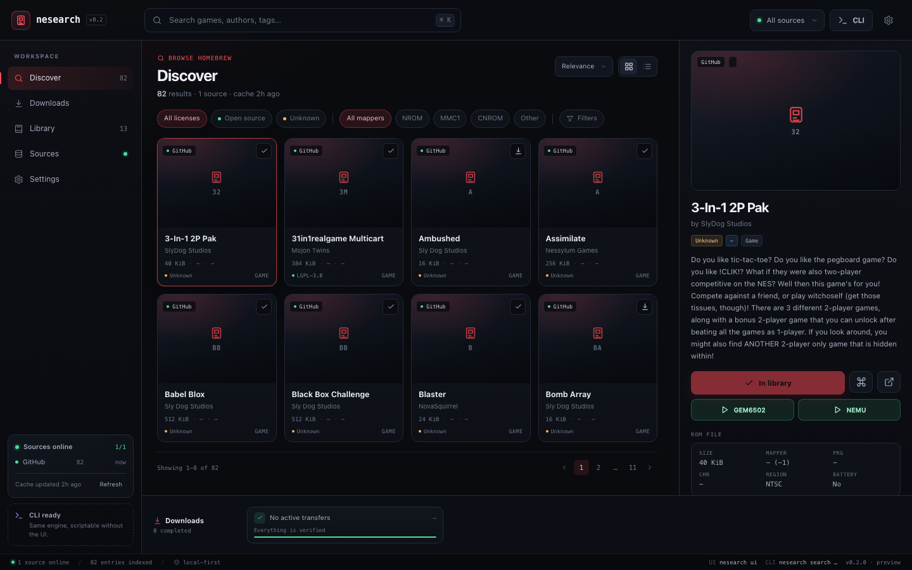
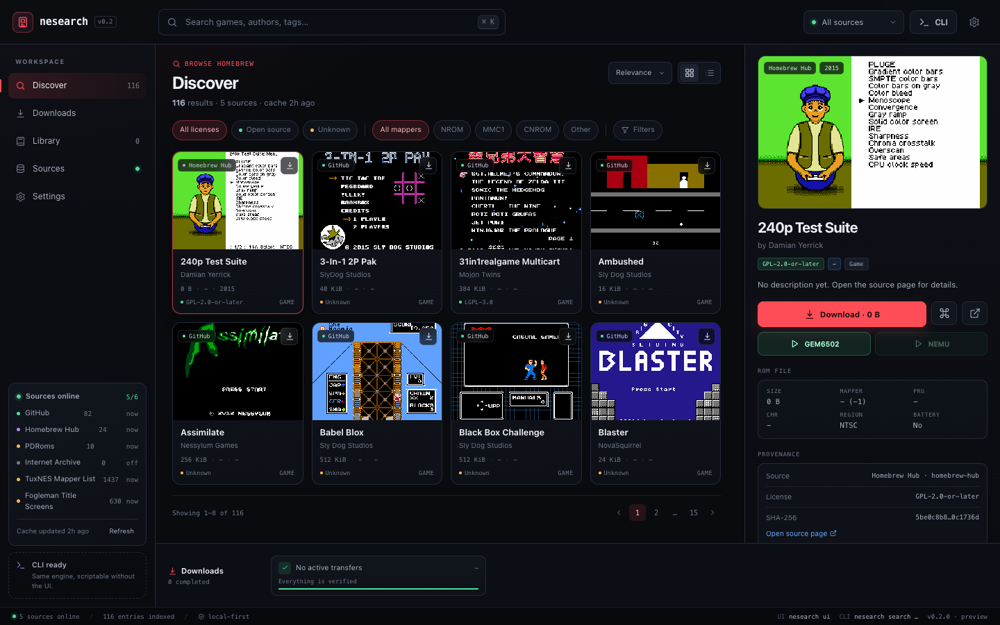

# nesearch

NES game search and download tool written in C++20, with both a **CLI** and a **local web UI**.

[中文 README](README.md)

> **Put childhood back into a chip.**

Current status: **runnable MVP** — GitHub catalog + Homebrew Hub + PDRoms RSS + custom JSON sources, download/verify/local library, local Web UI, and GEM6502/NEMU launch support.



## Features

- **Catalog search** across multiple sources, merged and de-duplicated by the core service.
- **CLI and UI parity** — both use the same `CatalogService`, `DownloadManager`, and `LibraryService`.
- **Download pipeline** — resumable transfers, retries, atomic rename, iNES header validation, SHA-256 verification, and a local library manifest.
- **Local Web UI** — search, detail pane, download queue, library, sources, settings, and CLI command preview.
- **Library views** — Grid and List modes, with play/reveal/remove actions.
- **Emulator launch** — open downloaded ROMs in **GEM6502** or **NEMU / 6502EMU**.
- **Custom JSON catalogs** — add a URL or local file, test connectivity, persist, and include it in search.
- **Metadata enrichment** — TuxNES mapper data (mapper/PRG/CHR/mirroring) and Fogleman title screenshots fill missing fields.
- **No license download gate** — licenses are displayed for information only; unknown licenses are marked amber and do not block downloads.

## Data sources

| Source | Type | Entries | Notes |
|---|---|---:|---|
| GitHub `retrobrews/nes-games` | Download catalog | 82 | Tree API + raw ROM assets; README title/author metadata |
| Homebrew Hub / `nesdev-org/homebrew-db` | Download catalog | 24 | Per-entry license/screenshot and optional SHA-256; ROMs via GitHub raw |
| PDRoms NES RSS | Download catalog | 10 | Latest RSS entries; ZIP downloads are extracted to a single `.nes` |
| Internet Archive | Download catalog | 0 in this network | Advanced Search + Metadata API; provider reports `offline` when unreachable |
| TuxNES Mapper List | Metadata | ~1,400 records | `nesmapper.txt`; title → mapper/PRG/CHR/mirroring |
| Fogleman NES Title Screens | Metadata | 630 screenshots | Title-screen gallery; fills missing cover images only |

Internet Archive is configurable from **Settings → Internet Archive**:

```text
(collection:softwarelibrary_nes OR collection:nes-homebrew) AND mediatype:software
```

Archive entries are enriched with TuxNES mapper data and Fogleman screenshots by normalized title.

## Build

Requirements:

- CMake ≥ 3.20
- C++20 compiler
- libcurl development headers

`nlohmann/json` and `cpp-httplib` are vendored under `third_party/`.

```sh
# From the repository root (macOS; use the system Apple clang)
cmake -S nesearch -B nesearch/build \
  -DCMAKE_BUILD_TYPE=Release \
  -DCMAKE_CXX_COMPILER=/usr/bin/clang++
cmake --build nesearch/build -j

ctest --test-dir nesearch/build --output-on-failure
```

Linux example:

```sh
sudo apt install build-essential cmake libcurl4-openssl-dev
cmake -S nesearch -B nesearch/build -DCMAKE_BUILD_TYPE=Release
cmake --build nesearch/build -j
```

## Run

```sh
# Fetch/refresh the catalog (first run can take about a minute)
cd /path/to/Open6502
./nesearch/build/nesearch update

# CLI
./nesearch/build/nesearch search "nova"
./nesearch/build/nesearch info falling
./nesearch/build/nesearch download falling -o ~/Downloads/nesearch
./nesearch/build/nesearch list
./nesearch/build/nesearch verify
./nesearch/build/nesearch sources
./nesearch/build/nesearch export --out build/catalog.json   # snapshot for the static site

# Local Web UI
./nesearch/build/nesearch ui
# nesearch UI  http://127.0.0.1:8420/?token=...
```

- Run the binary with no arguments in a TTY/desktop environment to open the UI.
- `ui --no-open` only prints the URL.
- `ui --port 8420` selects a fixed port; a busy port falls back to a random local port.
- The server binds only to `127.0.0.1`.
- The startup URL contains a one-time token; API requests require the token cookie or `X-NESearch-Token`.

### Workspace-local launcher

If `~/Downloads` is not writable (for example under a workspace sandbox), use:

```sh
cd /path/to/Open6502
./nesearch/run-ui.sh
```

The launcher sets:

```sh
NESEARCH_CONFIG=$PWD/config.sandbox.json
NESEARCH_CACHE_DIR=$PWD/.runtime/cache
NESEARCH_DATA_DIR=$PWD/.runtime/data
```

and downloads into `nesearch/downloads/`.

## Paths

Default macOS paths:

```text
~/Library/Application Support/nesearch/config.json
~/Library/Caches/nesearch/catalog.json
~/Library/Application Support/nesearch/library.json
~/Downloads/nesearch/
```

Overrides:

```sh
NESEARCH_CONFIG=/path/config.json
NESEARCH_CACHE_DIR=/path/cache
NESEARCH_DATA_DIR=/path/data
NESEARCH_UI_TOKEN=local-dev
NESEARCH_UI_NO_OPEN=1
```

## Release packaging (macOS)

```sh
bash nesearch/scripts/package-release.sh              # build + stage + zip
bash nesearch/scripts/package-release.sh --no-build   # reuse existing binaries
# -> dist/nesearch-<version>-macos-<arch>.zip plus a matching .sha256
```

- Layout: `nesearch`, `ui/`, `emulators/{gem6502,6502EMU}`,
  `lib/libSDL2-2.0.0.dylib`, `LICENSE`, `LICENSES/`, `README.md`, `run-ui.command`.
- The script rewrites the emulators' Homebrew SDL2 dependency to
  `@loader_path/../lib/` and ad-hoc signs every Mach-O file: `install_name_tool`
  invalidates the signature, and arm64 refuses to run unsigned binaries.
- Licenses travel with the archive: root `LICENSE` (MIT), and `LICENSES/` with
  NEMU's Mulan PSL v2 text plus NOTICE, SDL2 (zlib), MIT texts for
  nlohmann/json and cpp-httplib, and `THIRD_PARTY_NOTICES.md`.
- Needs `brew install sdl2`; override discovery with `SDL2_PREFIX=/path/to/sdl2`.

## Static catalog (GitHub Pages demo)

GitHub Pages can only serve static files, so it cannot host the `nesearch ui`
process. The online catalog is therefore an exported snapshot plus a browser
shim:



```sh
cmake --build nesearch/build -j
bash nesearch/scripts/build-static-site.sh          # writes site/nesearch/ (--refresh hits the network first)
python3 -m http.server -d site 8000                 # preview http://127.0.0.1:8000/nesearch/
node nesearch/scripts/test-static-site.mjs          # checks query engine, fetch shim, WASM player
```

- `nesearch export` writes the catalog to `site/nesearch/data/catalog.json`.
  Field shapes match the local `/api/v1/games` payload.
- [ui/static-api.js](ui/static-api.js) answers `/api/v1/*` in the browser.
  Search, filtering and sorting mirror `CatalogService::search`; downloads
  become `fetch` + browser save; play is delegated to [ui/play.html](ui/play.html),
  which runs `site/assets/play/gem6502.wasm` directly.
- The page is still [ui/mockup.html](ui/mockup.html); the build only injects a
  `window.NESEARCH_STATIC` line, so the local UI and the Pages demo share one
  frontend.
- Game details and the player page can share to X, Facebook, Reddit, Telegram,
  Hacker News, or copy the link; `?game=<id>` deep links open a single entry.
- The static build has **no** local library, resumable transfers, on-disk
  SHA-256 verification or local emulator launch — those stay in `nesearch ui`.
- [.github/workflows/pages.yml](../.github/workflows/pages.yml) builds nesearch,
  exports with `--refresh` and runs the node checks before deploying; if the
  export fails it falls back to [data/catalog.snapshot.json](data/catalog.snapshot.json).

## Custom JSON source

Sources page → **Add custom JSON source** → URL or local path → **Test connection** → Save.

Example: [`examples/catalog.example.json`](examples/catalog.example.json).

Minimal schema:

```json
{
  "schema": 1,
  "name": "my-catalog",
  "games": [
    {
      "id": "falling-example",
      "title": "Falling",
      "author": "tragicmuffin",
      "license": "MIT",
      "page_url": "https://github.com/tragicmuffin/falling-nes",
      "assets": [
        {
          "url": "https://raw.githubusercontent.com/retrobrews/nes-games/master/falling.nes",
          "filename": "falling.nes",
          "size": 40976
        }
      ]
    }
  ]
}
```

ZIP assets are supported; the first `.nes` file in the archive is extracted.

## Emulators

Auto-detected paths (relative to the repository):

```text
GEM6502/gem6502
NEMU/build/6502EMU
```

Launch commands:

```sh
GEM6502/gem6502 play <rom.nes>
NEMU/build/6502EMU <rom.nes>
```

Overrides:

```sh
NESEARCH_GEM6502=/path/to/gem6502
NESEARCH_NEMU=/path/to/6502EMU
```

The UI shows emulator availability in **Settings → Emulators**. Play buttons are disabled when an emulator is missing.

## Architecture

```text
CLI ──┐
      ├─> CatalogService / DownloadManager / LibraryService / Config
UI  ──┘                 │
                        ├─ GitHub provider
                        ├─ Homebrew Hub provider
                        ├─ PDRoms RSS provider
                        ├─ Internet Archive provider
                        ├─ custom JSON sources
                        └─ TuxNES / Fogleman metadata enrichment
```

Key files:

- `src/main.cpp` — CLI parser, commands, UI startup
- `src/catalog.cpp` — providers, caching, search, enrichment
- `src/download.cpp` — worker pool, resume, ZIP extraction, verification
- `src/ui_server.cpp` — loopback HTTP server and `/api/v1` routes
- `ui/mockup.html`, `ui/mockup.css`, `ui/mockup.js` — production UI (also usable as a static design preview)
- `ui/screenshots/` — design and live screenshots

UI API:

```text
GET  /api/v1/status
GET  /api/v1/games
GET  /api/v1/games/:id
GET  /api/v1/downloads
POST /api/v1/downloads
POST /api/v1/downloads/:id/pause|resume|remove
GET  /api/v1/library
POST /api/v1/library/verify
GET  /api/v1/sources
POST /api/v1/sources
POST /api/v1/sources/test
GET  /api/v1/emulators
POST /api/v1/play
POST /api/v1/open
POST /api/v1/update
GET/PUT /api/v1/config
```

## Current limitations

- Internet Archive is implemented but `archive.org` is unreachable from the current network; the source appears as `offline`.
- PDRoms currently uses the latest 10 RSS entries, not the full ~115-item catalog.
- Internet Archive currently accepts only direct `.nes` files, not `.zip`/`.rar` items.
- Homebrew Hub may omit a license for some entries; those are shown as `Unknown`.
- TuxNES is an old metadata list of mostly commercial titles; it has no download URLs, licenses, or hashes.
- Fogleman is a cover-art metadata source only; screenshot copyright remains with the respective owners.
- UI progress uses ~900 ms polling instead of SSE.
- macOS `.app` / Windows `.exe` packaging and Windows builds are not verified.
- Download pause depends on the transfer callback; very small files may finish first.

## Documentation

- [PRD.md](PRD.md) — product requirements, commands, data model, milestones
- [SOURCES.md](SOURCES.md) — data-source survey and implementation notes
- [UI_DESIGN.md](UI_DESIGN.md) — UI layout, interactions, API contract, acceptance criteria
- [ui/README.md](ui/README.md) — UI preview and deep links

## Legal note

The tool only indexes third-party homebrew and archive metadata. It does not include ROMs and does not bypass DRM, paywalls, or access controls. Licenses are informational only and do not block downloads in the UI. Users are responsible for how they use the catalog and the ROMs they download.
