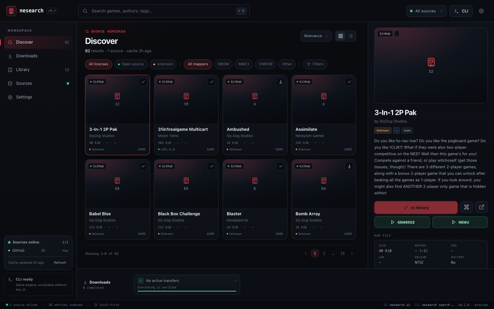
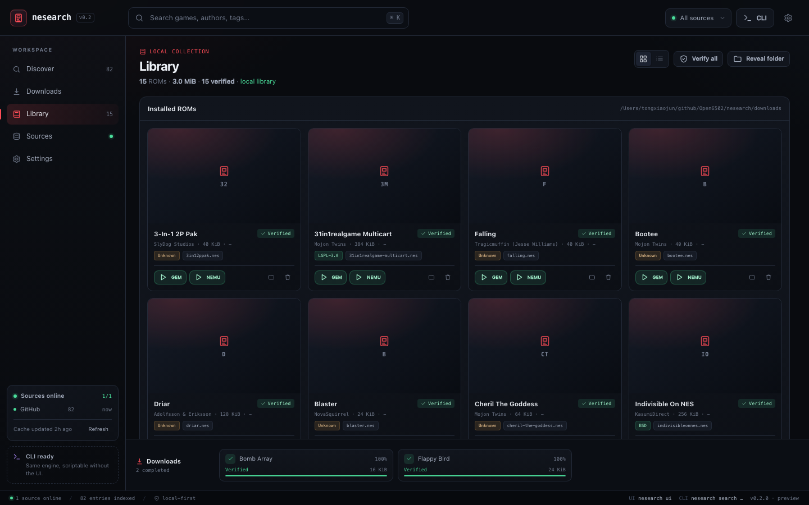

# nesearch

NES 游戏搜索与下载工具，C++20 实现，支持 **CLI + 本地 Web UI** 双模式。

当前状态：**可运行 MVP**（GitHub 目录 + 自定义 JSON 源 + 下载/校验/本地库 + 本地 UI）。



Library grid view:



| 文档 | 内容 |
|---|---|
| [PRD.md](PRD.md) | 产品需求、命令、数据源、C++ 技术方案、里程碑与验收 |
| [SOURCES.md](SOURCES.md) | 在线数据源调研：GitHub、Homebrew Hub、PDRoms、Internet Archive、itch.io 等 |
| [UI_DESIGN.md](UI_DESIGN.md) | CLI + UI 双模式设计、布局、交互、API 契约、UI 验收 |
| [ui/mockup.html](ui/mockup.html) | 可交互 UI 原型；也是当前 UI 的生产页面 |
| [ui/README.md](ui/README.md) | 原型打开方式与深链接 |

## 构建

依赖：CMake ≥ 3.20、C++20 编译器、libcurl（开发头文件）。`nlohmann/json` 与 `cpp-httplib` 已 vendor。

```sh
# macOS（使用系统 Apple clang + SDK curl）
cmake -S nesearch -B nesearch/build -DCMAKE_BUILD_TYPE=Release -DCMAKE_CXX_COMPILER=/usr/bin/clang++
cmake --build nesearch/build -j

# Linux（示例）
# sudo apt install build-essential cmake libcurl4-openssl-dev
# cmake -S nesearch -B nesearch/build -DCMAKE_BUILD_TYPE=Release
# cmake --build nesearch/build -j

ctest --test-dir nesearch/build --output-on-failure
```

## 使用

```sh
# 更新 GitHub 目录缓存（首次使用先执行）
./nesearch/build/nesearch update

# CLI
./nesearch/build/nesearch search "nova"
./nesearch/build/nesearch info falling
./nesearch/build/nesearch download falling -o ~/Downloads/nesearch
./nesearch/build/nesearch list
./nesearch/build/nesearch verify
./nesearch/build/nesearch sources

# UI：启动 loopback 服务并打开浏览器
./nesearch/build/nesearch ui
# nesearch UI  http://127.0.0.1:8420/?token=...
```

- 双击可执行文件 / 无参数运行（TTY + 桌面环境）默认打开 UI；非 TTY 回退 CLI/帮助。
- `ui --no-open` 只打印 HTTP 地址；`--port 8420` 固定端口；端口被占用时自动换随机端口。
- UI 只绑定 `127.0.0.1`；启动 URL 带一次性 token，API 需要该 token/cookie。
- UI 顶栏 `CLI` 按钮按当前筛选/选中/队列生成等价命令。
- 自定义 JSON 源：Sources 页 → `Add custom JSON source`，支持 HTTPS URL 或本地路径，Test connection 后保存。示例见 [examples/catalog.example.json](examples/catalog.example.json)。

配置/缓存/库路径（macOS）：

```text
~/Library/Application Support/nesearch/config.json
~/Library/Caches/nesearch/catalog.json
~/Library/Application Support/nesearch/library.json
```

## 已实现

- 内置源（自动合并、去重）：
  - GitHub `retrobrews/nes-games`：82 条，含 README 标题/作者与 `.png` 截图。
  - Homebrew Hub / `nesdev-org/homebrew-db`：24 条，带逐条许可证、截图与部分 SHA-256。
  - PDRoms NES RSS：最新 10 条，ZIP 下载后自动解出 `.nes`。
  - Internet Archive：Advanced Search + Metadata API，默认 query `(collection:softwarelibrary_nes OR collection:nes-homebrew) AND mediatype:software`；可在 Settings 修改。当前网络不可达时显示 offline，不阻塞其他源。
  - TuxNES Mapper List：抓取 `nesmapper.txt`，按标题归一化补充 mapper / PRG / CHR / mirroring（纯元数据，不是下载源）。
  - Fogleman NES Title Screens：630 张标题截图，按标题归一化补充缺失封面（纯元数据，没有 ROM 下载地址）。
- 搜索、过滤、排序、分页；详情懒加载 `.txt` 元数据（标题/作者/描述/许可证）。
- 下载：断点续传、重试、原子落盘、iNES 头解析、SHA-256、库清单、`list`/`verify`。
- 模拟器启动：下载后的游戏可在详情/Library 中直接选择 **GEM6502** 或 **NEMU** 打开；自动检测 `GEM6502/gem6502` 与 `NEMU/build/6502EMU`，可用 `NESEARCH_GEM6502` / `NESEARCH_NEMU` 覆盖。
- 本地 Web UI：搜索/详情/下载队列/库/源/设置；Library 支持 **Grid / List** 切换、模拟器启动；URL token 鉴权；SSE 未实现，当前轮询进度。
- 自定义 JSON 源（v0.2 确认项）：Test connection、添加、持久化、参与搜索、来源计数。
- 单元测试（SHA-256 / slug / 许可证识别等）。

## 当前限制

- PDRoms 当前只取 RSS 最新 10 条，未抓取全量约 115 条；ZIP 解压依赖系统 `unzip`（Windows 使用 `tar`）。
- Internet Archive Provider 已接入，但本机访问 `archive.org` 30s 超时；Sources 页显示 offline，网络/代理恢复后可用。
- itch.io 当前网络不可达，尚未接入；Homebrew Hub 部分条目无许可证字段，按 Unknown 展示。
- TuxNES 列表是旧版商业 ROM 标题/mapper 表，不含 URL/许可证/哈希；只用于未知 mapper 的元数据补全，不应当作 ROM 来源。
- Fogleman 页面是商业 NES 标题截图库，不含 ROM/许可证/下载链接；只用于封面补全，截图版权归各自权利人。
- 首次 `update` 需要请求多个源，约 1 分钟；之后走本地缓存。
- 截图 URL 来自 GitHub raw，网络不可达时 UI 使用像素占位图。
- 下载暂停依赖中断回调；极小的文件可能在暂停生效前完成。
- UI 使用轮询（约 900ms）而非 SSE；后续可替换。
- 代码签名、`.app`/`.exe` 包装、Windows 构建尚未验证。

## 设计决策

- 许可证**仅展示，不作为下载门槛**；未知许可证用琥珀色标记，不弹阻塞确认。
- 内置源不包含商业 ROM；自定义 JSON 源由用户配置，UI 不按许可证过滤结果。
- UI 采用本地 Web UI（loopback + 浏览器，后续 WebView 壳），不引入 Qt/ImGui。

### Sandboxed / no-write-to-~/Downloads

If the process cannot write to `~/Downloads` (for example under the DSH workspace sandbox), use the workspace-local launcher:

```sh
./nesearch/run-ui.sh
```

It sets `NESEARCH_CONFIG`, `NESEARCH_CACHE_DIR`, `NESEARCH_DATA_DIR` and uses
`nesearch/downloads/` as the download folder. The same paths can be overridden
with environment variables in any other environment.
