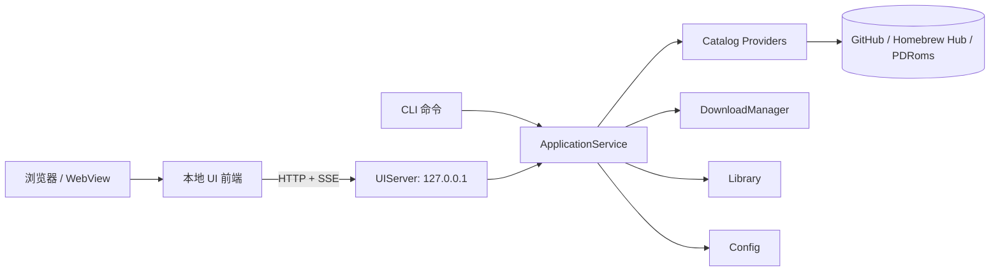

# nesearch UI 设计（CLI + UI 双模式）

| 项目 | 内容 |
|---|---|
| 设计版本 | v0.2（草案） |
| 日期 | 2026-11-11 |
| 关联文档 | [PRD.md](PRD.md) · [SOURCES.md](SOURCES.md) |
| 可交互原型 | [ui/mockup.html](ui/mockup.html) |
| 设计目标 | 搜索、筛选、查看详情、下载、管理本地库；与 CLI 共用同一套核心能力 |
| 技术建议 | 本地 Web UI（loopback HTTP + 浏览器/WebView），C++ 核心不依赖 Qt/ImGui |

> 设计稿：[Discover](ui/screenshots/discover.png) · [Downloads](ui/screenshots/downloads.png) · [Sources](ui/screenshots/sources.png) · [Add source](ui/screenshots/source-modal.png) · [Settings](ui/screenshots/settings.png) · [CLI](ui/screenshots/cli.png) · [Narrow](ui/screenshots/narrow.png) · [Live UI](ui/screenshots/live.png)
>
> 当前 `ui/mockup.html` 已被 `nesearch ui` 直接作为生产页面使用：直连 `/api/v1` 时显示真实目录/下载/库数据；用 `file://` 直接打开时自动回退为静态设计样例。真实下载和文件系统操作始终走 C++ 核心。

---

## 1. 目标与范围

### 1.1 要解决的问题

CLI 适合批量、脚本和 CI，但“搜索 → 比较 → 选择 → 下载 → 看进度”是明显的视觉任务。UI 模式需要：

- 一个搜索框就能看到跨源结果，不用记命令和 ID。
- 结果卡片能快速比较标题、作者、大小、mapper、许可证、来源。
- 选中游戏后能看截图、描述、ROM 头和来源，再决定是否下载。
- 下载队列可见、可暂停/恢复/重试，完成后能看到文件与校验状态。
- 本地库可查、可校验、可定位文件。
- 所有操作都能映射回一条 CLI 命令，方便复制到脚本/终端。

### 1.2 非目标

- 不做模拟器前端，不在 UI 内运行游戏。
- 不做账号、云同步、社区评分。
- 不做远程 Web 服务；UI 只监听 loopback。
- 不改变下载/校验/缓存的核心逻辑；UI 是核心之上的展示层。

### 1.3 产品决策：许可证只做信息展示

按当前产品决策，**许可证不作为下载门槛**：搜索到的条目都允许发起下载。UI 仍展示 `license` 与来源，便于识别；未知许可证用琥珀色标记，但不弹确认框、不禁用按钮。

这条决策只影响 UI 的门槛，不改变数据源边界：是否出现在结果中由启用的源决定；内置源仍是公开的 homebrew/API 源，自定义 JSON 源由用户自行配置。UI 不实现 DRM/付费墙绕过。

---

## 2. 双模式定义

### 2.1 启动矩阵

| 场景 | 命令 | 行为 |
|---|---|---|
| 打开 UI | `nesearch ui` | 启动 loopback 服务，打印 HTTP 地址，打开默认浏览器 |
| 双击可执行文件 / 无参数（TTY + 桌面环境） | `nesearch` | 等同于 `nesearch ui`，默认打开 UI |
| 无参数（非 TTY / CI） | `nesearch` | 打印简短帮助，退出码 0，不启动服务 |
| 显式 CLI | `nesearch search …` | 只走 CLI，不启动 UI |
| 无头模式 | `NESEARCH_HEADLESS=1 nesearch` | 强制 CLI/帮助 |
| 只起服务 | `nesearch ui --no-open --port 0` | 打印本地 URL 与 token，不自动开浏览器 |
| 指定前端目录（开发） | `nesearch ui --ui-dir ./nesearch/ui` | 从磁盘加载，便于改 CSS/JS |

约定：

- `ui` 是显式子命令；其他子命令永远按 CLI 解释。
- UI 端口默认 `0`（系统分配），只绑定 `127.0.0.1`；`--port 8420` 可固定端口。
- 启动时打印 `http://127.0.0.1:<port>/#token=<one-time>`；默认尝试打开浏览器，`--no-open` 只打印地址。
- 非 TTY 下无参数不启动服务，避免脚本误挂起；`NESEARCH_HEADLESS=1` 同样强制 CLI。

```sh
$ nesearch ui
nesearch UI  http://127.0.0.1:8420/#token=...
Opening default browser…
```

双击行为：

| 平台 | 行为 |
|---|---|
| macOS | 随包提供 `nesearch.app`（或 `.command` 包装），双击执行 `nesearch ui`；也可在终端运行二进制。 |
| Windows | `nesearch.exe` 双击启动控制台并打开 UI；发布版可切换 GUI subsystem 隐藏控制台。 |
| Linux | 提供 `.desktop` 文件执行 `nesearch ui`；文件管理器双击二进制时按 TTY 检测处理。 |

### 2.2 共享核心

```text
CLI 命令 ─┐
          ├─> ApplicationService ─> Catalog / Download / Library / Config
UI API  ──┘
```

- UI 不直接访问 GitHub/PDRoms/文件系统；只调用本地 API。
- CLI 与 UI 调用同一组 `ApplicationService` 方法，避免两套业务逻辑。
- 搜索、排序、过滤、下载状态、校验、库清单都在核心层实现。
- UI 的“复制 CLI 命令”由共享的 `CommandBuilder` 生成，保证参数一致。

### 2.3 CLI 镜像

顶栏的 `CLI` 按钮打开命令面板，按当前 UI 状态生成：

```sh
# Search what the UI is showing
nesearch search "nova" --source all --license any --sort relevance

# Download the selected game
nesearch download nova -o ~/Downloads/nesearch

# Or download the whole active queue
nesearch download nova thwaite --jobs 4

# Open the UI (prints http://127.0.0.1:<port>)
nesearch ui --port 8420
```

- 每个页面/详情/队列都有对应的“复制命令”入口。
- 命令面板只展示，不执行；执行仍由用户决定（避免 UI 变成终端模拟器）。
- 未来可加“在终端中运行”，但 P2。

---

## 3. 设计原则

| 原则 | 落地 |
|---|---|
| 搜索优先 | 搜索框常驻顶栏；`⌘K` / `/` 聚焦；输入即过滤 |
| 一眼可比 | 卡片固定展示标题、作者、大小、mapper、许可证、来源 |
| 详情不打断 | 桌面端右侧详情栏；窄屏变全屏抽屉，不离开结果列表 |
| 下载可感知 | 底部常驻下载托盘；状态、进度、速度、校验结果可见 |
| 双模一致 | 同一数据、同一动作、同一错误码；UI 显示 CLI 等价命令 |
| 低摩擦 | 默认值合理；没有许可证弹窗；未知信息用颜色标注而不是阻塞 |
| 本地优先 | 不依赖远程服务；离线时展示缓存并在顶部提示 |

---

## 4. 技术路线

### 4.1 选型对比

| 方案 | 优点 | 代价 | 结论 |
|---|---|---|---|
| Dear ImGui + SDL2 | 单二进制、原生窗口、与现有 SDL 技术栈接近 | 复杂布局/滚动/文本输入/无障碍成本高；与这套视觉差距大 | 备选 |
| Qt 6 Widgets/QML | 原生、无障碍/IME 好、生态成熟 | 依赖重（数十 MB），构建/分发复杂 | 备选 |
| 本地 Web UI（推荐） | HTML/CSS/JS 迭代快，视觉还原度高，跨平台，依赖少（单头 HTTP server） | 浏览器标签页；需要 loopback 安全设计 | **首选** |
| WebView 壳（Phase 2） | 保留 Web UI 的视觉，同时有原生窗口 | 三平台各一套 WebView 依赖 | 后续增强 |

推荐路径：

1. **v0.2**：`nesearch ui` 启动 loopback server，默认浏览器打开；前端资源嵌入二进制。
2. **v0.3**：可选 `--native`，用 WebView 壳（macOS WKWebView / Windows WebView2 / Linux WebKitGTK）提供原生窗口。
3. 不在 v0.2 引入 Qt/ImGui。

### 4.2 架构



### 4.3 安全模型

- 只绑定 `127.0.0.1`，拒绝非 loopback 的 `Host`/`Origin`。
- 每次启动生成一次性 token；通过 URL fragment 传给前端，换取 `HttpOnly; SameSite=Strict` cookie。
- API 要求 `X-NESearch-Token` 或 cookie；写操作校验 `Origin`/`Sec-Fetch-Site`。
- 不使用 `eval`；前端静态资源使用 CSP；不加载远程脚本/字体。
- 服务进程退出即失效；不写入日志的 token。
- 前端不直接读文件系统；下载目录、文件操作都由核心层按配置执行。
- 默认只允许 HTTPS 上游；自定义源若使用 HTTP，需显式配置（本地测试除外）。

### 4.4 UI API（契约草案）

| 方法 | 路径 | 用途 |
|---|---|---|
| GET | `/api/v1/status` | 版本、缓存年龄、源状态、活动下载数 |
| GET | `/api/v1/sources` | 源列表、条目数、最后同步、能力 |
| POST | `/api/v1/sources/:id/refresh` | 刷新单个源 |
| POST | `/api/v1/sources` | 添加自定义 JSON 源（v0.2） |
| POST | `/api/v1/sources/test` | 校验 URL/路径与 schema |
| PUT | `/api/v1/sources/:id` | 启用/禁用、修改刷新间隔 |
| DELETE | `/api/v1/sources/:id` | 移除自定义源 |
| GET | `/api/v1/games?q=&license=&mapper=&source=&sort=&page=` | 搜索/过滤/排序 |
| GET | `/api/v1/games/:id` | 详情（含 ROM 头、哈希、来源） |
| POST | `/api/v1/downloads` | `{ids:[...], output?}` 入队 |
| GET | `/api/v1/downloads` | 队列快照 |
| PATCH | `/api/v1/downloads/:id` | `pause` / `resume` / `cancel` / `retry` |
| GET | `/api/v1/events` | SSE：进度、状态、toast 事件 |
| GET | `/api/v1/emulators` | 检测 GEM6502 / NEMU 可执行文件 |
| POST | `/api/v1/play` | `{id, emulator}` 启动本地模拟器 |
| GET | `/api/v1/library` | 本地库清单 |
| POST | `/api/v1/library/verify` | 校验全部/指定文件 |
| GET/PUT | `/api/v1/config` | 读取/更新配置（写操作需 token） |
| POST | `/api/v1/open` | 仅打开已下载文件所在目录（受路径白名单限制） |

错误统一为：

```json
{"code":"rate_limited","message":"GitHub rate limit exceeded","hint":"Set GITHUB_TOKEN or retry after 21:00","exit_code":9}
```

---

## 5. 信息架构

| 页面 | 目的 | 主要动作 |
|---|---|---|
| Discover | 搜索、筛选、比较、下载 | 搜索、筛选、排序、切换视图、下载、查看来源 |
| Downloads | 管理活动队列 | 暂停/恢复/取消/重试、查看速度/大小/校验 |
| Library | 管理已下载 ROM | 校验、定位文件、查看 mapper/哈希 |
| Sources | 管理数据源 | 刷新、启用/禁用、添加自定义 JSON 源 |
| Settings | 配置 | 下载目录、并发、代理、Token、主题 |
| Detail | 当前选中游戏 | 下载、复制 CLI、打开来源页 |

侧栏固定 5 个入口；详情不是独立页面，是 Discover 的右栏。

---

## 6. 视觉系统

### 6.1 风格

“Retro-modern”：深色底、低饱和面板、NES 红作为唯一主强调色；像素截图保留 `image-rendering: pixelated`，但 UI 字体、间距、圆角保持现代桌面工具质感。避免 CRT 扫描线、霓虹泛滥和像素字体正文。

### 6.2 设计令牌

| 类别 | 值 |
|---|---|
| 背景 | `#090B0F` / 面板 `#11151D` / 抬升 `#161B25` |
| 边框 | `#232A38` / 强边框 `#323B4D` |
| 文字 | 主 `#EEF2F8` / 次 `#A6AFC0` / 弱 `#6F788A` |
| 主强调 | `#FF4D57`（NES 红） |
| 状态 | 成功 `#4ADE9B` / 警告 `#FFB454` / 信息 `#67A8FF` / 来源紫 `#B08CFF` |
| 圆角 | 卡片 12px；面板 11px；按钮 8px；chip 999px |
| 间距 | 4 / 8 / 12 / 16 / 24 / 32 |
| 阴影 | 卡片 hover `0 14px 34px rgba(0,0,0,.34)`；modal `0 30px 90px rgba(0,0,0,.55)` |
| 字体 | UI：Inter/system sans，13px 基准；数据/哈希：ui-monospace，9–11px |
| 图标 | 1.8px stroke，16px；线性图标，统一 24 视图盒 |

### 6.3 组件

| 组件 | 规格 |
|---|---|
| 搜索框 | 38px 高，左搜索图标，右 `⌘K`；focus 红色描边 + 3px 光晕 |
| 过滤 chip | 29px 高，圆角 999；激活为红色半透明底 + 红边 |
| 游戏卡片 | 4:3 截图；顶部来源/下载；底部标题/作者/大小/mapper/许可证 |
| 详情栏 | 368px；截图 3:2；标题 21px；元数据 3 列；来源/哈希 |
| 下载托盘 | 92px；每项 188–310px；2px 进度条；完成态绿色 |
| 表格 | 10.5px 正文；行高 40px；mono 列用于文件/哈希 |
| 源卡片 | 3 列自适应；状态点、条目数、最后同步、配置按钮 |
| 弹窗 | 610px；用于 CLI 命令/冲突确认；ESC 关闭 |

### 6.4 色彩语义

- **红**：主操作、选中、活动下载；不用于错误（错误用红 + 文案/图标）。
- **绿**：已验证、在线、可下载。
- **琥珀**：未知许可证、队列、需注意。
- **蓝/紫**：来源标签、信息链接、辅助状态。
- 状态不能只靠颜色：必须同时有文字/图标（满足色盲可用性）。

---

## 7. 页面规格

### 7.1 Discover（主页面）

```text
┌ topbar: brand | search ⌘K | source filter | CLI | settings ┐
├ sidebar ┬──────────────── main ────────────────┬ detail ┤
│ nav     │ title / count / sort / grid-list     │ hero   │
│ sources │ license + mapper chips                │ title  │
│ status  │ ┌ card ┐ ┌ card ┐ ┌ card ┐ ┌ card ┐  │ meta   │
│         │ └──────┘ └──────┘ └──────┘ └──────┘  │ source │
│         │ pagination                            │        │
├─────────┴──────────── download tray ───────────┴────────┤
└ status bar: sources / cache / CLI hints                 ┘
```

- 顶栏：品牌、全局搜索、源筛选、CLI、设置。
- 标题区：`Discover`、`8 of 221 games · 3 sources · cache 2h ago`、排序、网格/列表切换。
- 过滤行：许可证（All / Open source / Unknown）、mapper（All / NROM / MMC1 / CNROM / Other）、Filters。
- 结果区：4 列卡片（1440 宽、详情栏展开时）；卡片 hover 抬升；选中红边。
- 分页：`Showing 1–8 of 221`，页码 + 前后翻页。
- 详情栏：当前选中游戏；不打断结果浏览。

**空状态**：无结果时展示查询词、清除按钮；“Search all sources”只作为提示，不自动改查询。
**加载状态**：4–8 个骨架卡片，保留布局高度；不显示 spinner 抖动。
**离线状态**：顶部细横幅 `Offline — showing cached catalog (2h old)`；下载按钮禁用并显示原因。

### 7.2 卡片

| 区域 | 内容 |
|---|---|
| 截图 | 4:3，pixelated；无截图时用 NES 卡带占位图 |
| 顶部左 | 来源 pill（GitHub / Homebrew Hub / PDRoms） |
| 顶部右 | 下载按钮；已下载显示 ✓ |
| 标题 | 单行省略；hover 显示全名 |
| 作者 | 单行省略 |
| 元数据 | 大小 · mapper · 年份 |
| 底部 | 许可证（绿点/琥珀点） + `game`/`tool` |
| 进行中 | 底部 2px 进度条，不遮标题 |

### 7.3 详情栏

- 大截图 + 来源/年份徽标。
- 标题、作者。
- chips：许可证、mapper、类型、battery。
- 描述（2–3 行，超出折叠）。
- 主按钮：`Download · 40 KiB`；下载中 `Downloading 64%`；完成 `In library`。
- 完成后显示 **Play** 操作：`GEM6502` / `NEMU` 两个按钮，调用本地模拟器打开 ROM。
- 图标按钮：复制 CLI、打开来源页。
- 进度：4px 条 + 百分比/速度。
- ROM 文件：Size / Mapper / PRG / CHR / Region / Battery（3 列 × 2 行）。
- Provenance：Source · catalog、License、SHA-256、来源页链接。
- 所有源都允许下载；unknown license 只显示琥珀 chip，不阻断。

### 7.4 Downloads

- 顶部：`Downloads` + 活动/排队统计 + Pause all / Clear completed。
- Active & queued 表格：Game、Source、Progress（条+百分比/Queued）、Speed、Size、Actions（暂停/继续/移除）。
- Completed 表格：Game、File、SHA-256、Status（Verified）、Actions（定位/移除）。
- 空状态：`No active downloads`，引导回 Discover。
- 托盘同步显示前 3 项；点击托盘项定位到 Discover 详情。

### 7.5 Library

- 顶部：`12 ROMs · 4.8 MiB · 12 verified · all files present`。
- 视图：**Grid / List** 切换。
  - Grid：截图、标题、作者、大小/mapper、许可证、Verified 状态、GEM6502/NEMU 启动按钮、Reveal/Remove。
  - List：Game、File、Mapper、Size、SHA-256、Status、Actions 表格。
- Verify all：逐项重算哈希/解析头；失败行红色状态。
- Reveal folder：打开下载目录。
- 文件缺失：`missing` 状态 + “Locate”提示。

### 7.6 Sources

- 每个源一张卡：名称、类型、状态点、条目数、最后同步、并发/预算、Configure。
- 内置源：GitHub、Homebrew Hub、PDRoms。
- Add custom JSON source（**v0.2 必做**）：虚线卡打开表单：
  - Display name
  - Catalog URL 或本地路径（默认仅 HTTPS；本地文件需显式允许）
  - Refresh interval（6h / 24h / manual）
  - Enable for search immediately
  - Test connection（校验可达性与 schema v1），通过后才允许保存
  - 保存后立即出现在源列表并参与搜索；写入配置，重启后保留
- 源能力徽标：`direct download` / `metadata only` / `requires proxy` / `license metadata`。
- 全部启用源参与搜索；禁用源仍保留缓存。

### 7.7 Settings

- Downloads：目录、并发、断点续传、SHA-256。
- Network：HTTPS 代理、GitHub Token（掩码）。
- Interface：主题、密度、许可证显示（仅信息，不阻断）。
- Local server：显示 `http://127.0.0.1:<port>`，复制地址、打开浏览器、固定端口。
- Emulators：自动检测 GEM6502 / NEMU 路径与状态；支持环境变量覆盖。
- CLI parity：`nesearch ui` / `nesearch search … --json` / `nesearch download …`。
- About：版本、核心版本、检查更新。

### 7.8 首次运行

三步轻量引导（可跳过）：

1. 选择下载目录。
2. 选择默认源（GitHub 勾选；Homebrew Hub 勾选；PDRoms 说明许可混杂，默认关闭）。
3. 可选 GitHub Token；`Start browsing`。

不做登录、不做云同步。

---

## 8. 搜索与下载行为

### 8.1 搜索

- 输入即搜，180–220ms 防抖；本地索引优先，不阻塞输入。
- 查询按空白切分，全部 token 命中（AND）；匹配标题、作者、ID、标签、来源、许可证。
- 大小写不敏感；ASCII 折叠变音符号。
- 过滤器即时生效，不重新请求网络。
- 排序：Relevance / Title A–Z / Size / Newest。
- 搜索无结果退出 0；UI 展示空状态，不弹错误。

### 8.2 过滤

| 过滤器 | 值 |
|---|---|
| License | All / Open source / Unknown（当前只做展示分类） |
| Mapper | All / NROM / MMC1 / CNROM / Other |
| Source | All / GitHub / Homebrew Hub / PDRoms |
| Sort | Relevance / Title / Size / Newest |

### 8.3 下载状态机

```text
queued -> downloading -> verifying -> done
   |          |  ^
   |          v  |
   |        paused
   v
 canceled
```

| 状态 | UI |
|---|---|
| queued | 灰色/琥珀，进度 0；可移除 |
| downloading | 红色进度条、速度、百分比；可暂停 |
| paused | 播放按钮；百分比保留 |
| verifying | 进度条满，文案“Verifying SHA-256…” |
| done | 绿色 ✓；写入 Library |
| failed | 红色；错误原因 + Retry |
| canceled | 从队列移除；`.part` 保留策略按配置 |

### 8.4 下载冲突

目标文件已存在时弹窗（不是许可证弹窗）：

- `Keep existing`（默认）
- `Replace`（覆盖，需确认）
- `Choose another folder`

### 8.5 许可证

- 展示 `license`、`source`、`source page`、`SHA-256`。
- 未知许可证：琥珀 badge，不阻断下载、不弹确认。
- 设置里可关闭许可证显示；不影响下载。
- 不提供“仅下载开源”强制过滤；筛选器只是视图。

---

## 9. 键盘与无障碍

| 快捷键 | 行为 |
|---|---|
| `⌘K` / `Ctrl+K` | 聚焦搜索 |
| `/` | 搜索（非输入态） |
| `Esc` | 关闭弹窗/详情抽屉/清空焦点 |
| `↑` / `↓` | 在结果卡片间移动焦点 |
| `Enter` | 打开详情 |
| `D` | 下载当前选中 |
| `O` | 打开来源页 |
| `G` / `L` | 网格/列表切换 |
| `1`–`5` | Discover / Downloads / Library / Sources / Settings |
| `?` | 快捷键帮助 |

无障碍要求：

- 所有可点击元素有可见 focus ring（2px 红色 + 2px offset）。
- 图标按钮有 `aria-label`；状态有文字，不只靠颜色。
- 对比度 ≥ 4.5:1（正文）；大字号 ≥ 3:1。
- 支持 `prefers-reduced-motion`；进度更新不引发布局跳动。
- 表格有 `<th>` 语义；弹窗焦点陷阱；ESC 关闭。
- 字体缩放 200% 不截断关键操作。

---

## 10. 响应式

| 宽度 | 布局 |
|---|---|
| ≥ 1280 | 侧栏 224 + 主区 + 详情 368 |
| 1024–1279 | 侧栏 200 + 主区；详情变右侧抽屉（overlay） |
| 760–1023 | 侧栏收为 56px 图标；卡片 2 列；详情全屏 sheet |
| < 760 | 单列；底栏导航；详情 sheet；下载托盘可折叠 |

桌面端优先；首版不追求手机完整功能，但保证窗口缩小时不破版。

> 原型在 1440px 与 1100px 两档验证：≤1220px 时详情变为右侧抽屉（[narrow.png](ui/screenshots/narrow.png)）；≤1000px 的移动布局仍是设计目标，未在原型中完整实现。

---

## 11. 实现映射

### 11.1 C++ 侧

| 模块 | 职责 |
|---|---|
| `src/ui_server.cpp` | cpp-httplib、静态资源、token/cookie、CSP、loopback 绑定 |
| `src/ui_api.cpp` | JSON 路由 → `ApplicationService`；SSE 广播 |
| `src/app/service.cpp` | CLI/UI 共享用例：search/download/library/sources |
| `src/download/manager.cpp` | 队列、线程池、状态机、进度回调 |
| `src/catalog/*` | GitHub / Homebrew Hub / PDRoms / JSON Provider |
| `src/library/*` | 清单、校验、路径 |
| `src/config/*` | 配置读写；UI Settings 同一份 |

### 11.2 前端侧

```text
nesearch/ui/
├── mockup.html          # 设计原型（本文件）
├── mockup.css
├── mockup.js
├── assets/              # 截图素材（原型用）
├── screenshots/         # 设计评审截图
└── app/                 # 生产前端（后续）
    ├── index.html
    ├── app.css
    ├── app.js
    └── assets/
```

- v0.2 前端可用原生 JS + CSS（无框架），减小体积；状态管理用简单 store。
- 资源通过 CMake 嵌入（`xxd -i` 或自定义脚本），也可 `--ui-dir` 从磁盘加载。
- 开发模式：`nesearch ui --ui-dir ./nesearch/ui/app --no-open`。

### 11.3 数据流

1. 页面加载 → `GET /status` + `/sources` + `/games?page=1`。
2. 输入搜索 → 180ms 防抖 → `/games?q=…`。
3. 选中卡片 → `/games/:id`（详情可先用列表数据渲染，再补 ROM 头/哈希）。
4. 点击下载 → `POST /downloads` → SSE 推送进度 → 完成后刷新 `/library`。
5. 设置保存 → `PUT /config` → 核心层立即生效。

---

## 12. 验收标准（UI）

| ID | 验收 |
|---|---|
| UI-AC-01 | `nesearch ui` 启动后浏览器打开，搜索框自动聚焦，5 个导航可用。 |
| UI-AC-02 | 输入关键词 + 许可证 + mapper 过滤，结果数量与 CLI `search --json` 一致。 |
| UI-AC-03 | 点击卡片显示详情；`D`/下载按钮入队；托盘、Downloads 页、Library 页状态一致。 |
| UI-AC-04 | 暂停/恢复/取消/重试在 UI 与 CLI 中产生相同状态。 |
| UI-AC-05 | 未知许可证条目仍可下载，只显示琥珀标记，不出现阻塞弹窗。 |
| UI-AC-06 | 顶栏 CLI 面板生成与当前查询/选择/队列一致、可直接执行的命令。 |
| UI-AC-07 | 非 loopback 访问被拒绝；无 token 的写请求返回 403；token 不出现在日志。 |
| UI-AC-08 | 1024px 宽度下详情变抽屉，核心操作不被遮挡。 |
| UI-AC-09 | 键盘可完成搜索、选择、下载、暂停；焦点可见；对比度通过检查。 |
| UI-AC-10 | 冷启动 UI ≤ 1.5s（本机、缓存已存在）；搜索输入无可感知卡顿。 |
| UI-AC-11 | 双击/无参数启动默认打开 UI；终端打印 `http://127.0.0.1:<port>`；`--no-open` 只打印地址。 |
| UI-AC-12 | 在 Sources 页添加 JSON 源：Test 通过后可保存，源立即参与搜索，重启后仍在。 |
| UI-AC-13 | 打印的 HTTP 地址只在本机可访问；非 loopback 请求被拒绝。 |
| UI-AC-14 | 已下载游戏可从详情/Library 选择 GEM6502 或 NEMU 启动；缺失模拟器时按钮禁用并提示。 |

---

## 13. 决策记录与待确认

已确认（2026-11-11）：

1. **本地 Web UI** 路线，服务启动时提供并打印 HTTP 访问地址。
2. **双击 / 无参数默认打开 UI**（TTY + 桌面环境）；非交互环境回退 CLI/帮助。
3. **添加自定义 JSON 源**进入 v0.2，包含 Test connection 与持久化。

仍待确认：

1. 顶部 `CLI` 面板是否需要“在终端中运行”，还是仅复制命令？
2. 是否保留许可证信息展示（推荐保留，不阻断下载）？
3. UI 文案英文 + 中文文档是否可接受？是否需要 `--lang zh-CN`？
4. 自定义源是否允许 `file://`/本地路径（推荐允许，但需显式开关）？

---

## 14. 参考

- 可交互原型：[ui/mockup.html](ui/mockup.html)
- 截图：[Discover](ui/screenshots/discover.png) · [Downloads](ui/screenshots/downloads.png) · [Sources](ui/screenshots/sources.png) · [Add source](ui/screenshots/source-modal.png) · [Settings](ui/screenshots/settings.png) · [CLI](ui/screenshots/cli.png) · [Narrow](ui/screenshots/narrow.png)
- 产品需求：[PRD.md](PRD.md)
- 数据源调研：[SOURCES.md](SOURCES.md)
