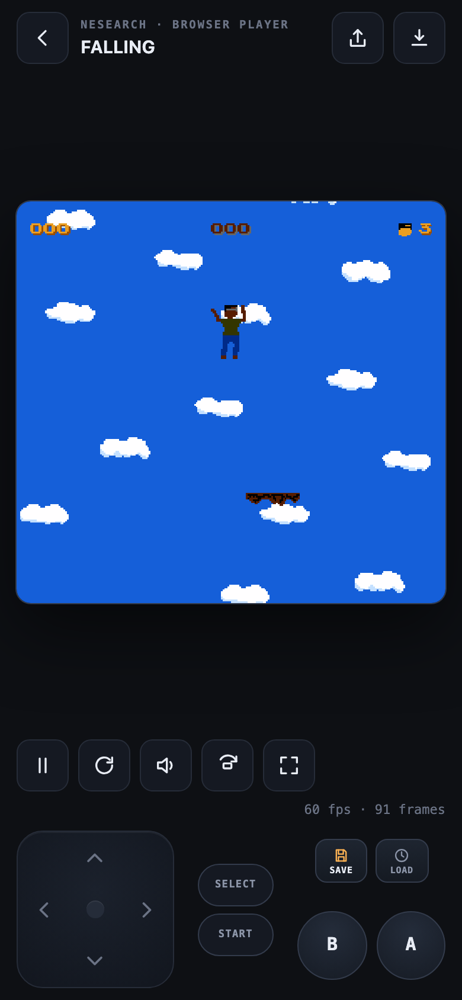
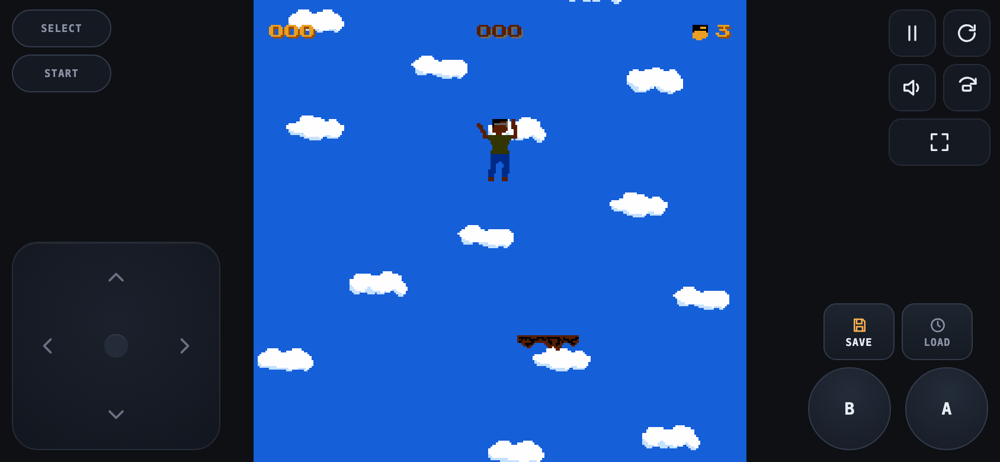
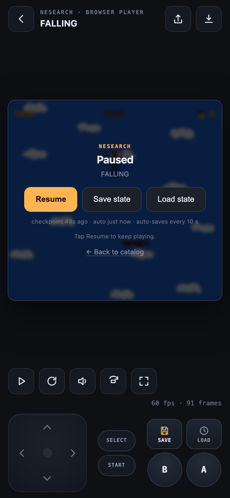
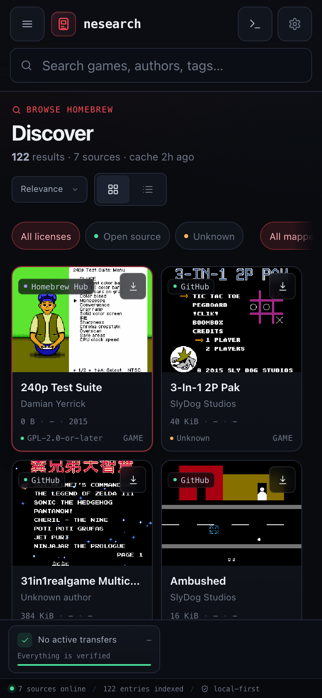

# nesearch UI prototype

Interactive UI for the CLI + UI dual-mode product. Opened directly (`file://`) it is a static design preview; served by `nesearch ui` it uses the live local API for search, downloads, library, and sources.

## Open it

```sh
open nesearch/ui/mockup.html
```

Or drag `mockup.html` into Chrome/Safari; without the local API it falls back to the sample data. With the built binary:

```sh
./build/nesearch ui
# open the printed http://127.0.0.1:<port>/?token=... URL
```

Screenshots under `assets/` are local; live catalog images come from the configured source URLs.

## Deep links

| URL | State |
|---|---|
| `mockup.html` | Discover with Nova selected |
| `mockup.html?view=downloads` | Download queue |
| `mockup.html?view=library` | Local library |
| `mockup.html?view=sources` | Source manager |
| `mockup.html?view=settings` | Settings |
| `mockup.html?q=contra` | Empty search state |
| `mockup.html?layout=list` | List view |
| `mockup.html?cli=1` | CLI command modal |
| `mockup.html?source=1` | Add JSON source modal |

## What is interactive

- Search, license/mapper filters, source filter, sort, grid/list toggle.
- Card selection and detail panel.
- Download button → queue → progress simulation → verified state.
- Pause/resume/remove in the panel or tray.
- Sidebar navigation, CLI command modal, add-source modal, copy button, toasts.
- Settings → Local server panel with `http://127.0.0.1:8420` copy/open actions.
- Keyboard: `⌘K`/`Ctrl+K` search, `/` search, `Esc` close.

## Scope

This is a visual/interaction specification, not the production frontend. The production UI will be served from `127.0.0.1` by the C++ core and use the API in [../UI_DESIGN.md](../UI_DESIGN.md#44-ui-api契约草案).

The 8 sample games use real homebrew metadata and screenshots for realism; they are not bundled ROMs.

## Mobile

| Portrait | Landscape |
| --- | --- |
|  |  |





Both the catalog (`mockup.html`) and the player (`play.html`) respond to the
viewport instead of scaling the desktop app down:

- **≤860px wide or ≤560px tall in landscape:** the sidebar becomes an
  off-canvas drawer (`#menuBtn` / `#scrim` / `#sidebarClose`), the detail panel
  becomes a sheet, the download tray turns into a horizontal strip and tables
  scroll sideways. Filter chips scroll horizontally instead of wrapping.
- **Landscape phones:** one-row top bar, three-column grid, no download tray,
  detail panel slides in from the right.
- **`play.html`:** thumb pad in portrait, controls in the side margins in
  landscape, fullscreen button, wake lock, auto-pause on tab switch.

`bindMobileShell()` in `mockup.js` owns the drawer/sheet behaviour;
`play.js` owns `fitStage()` (canvas sizing) and the touch input map. The
published copy under `site/nesearch/` is generated by
`nesearch/scripts/build-static-site.sh`, so edit these files, not that tree.

### Save states and rotation

The player keeps two save-state slots per game, both in `localStorage`:

- **auto**: captured every 10 s while playing, when the tab is hidden and when
  pausing; it is the "last state" after a crash or refresh;
- **checkpoint**: written only by the Save button (or `F2`), so a deliberate
  safe spot is not overwritten by the rolling save.

The wasm core serialises CPU/PPU/APU/bus/mapper state (`gem_web_save_state`,
`gem_web_load_state`); the record is ~65 KB. "Load state" (`F3`, the clock
button, or the overlay button) restores the checkpoint while playing and the
most recent auto state on a fresh page, including after the CPU halts. The
overlay shows the age of both slots.

The rotate button (`L`) asks for fullscreen and calls
`screen.orientation.lock("landscape")`, which Android Chrome supports. iOS
Safari cannot lock orientation, so the button explains that the phone has to
be turned by hand — the layout already switches to the landscape arrangement
on its own.

### Immersive fullscreen

Entering fullscreen (or the iOS `immersive` fallback) adds `input-lock` to the
body and keeps it until fullscreen is left:

- a capture-phase `keydown` guard blocks browser shortcuts (Ctrl/Cmd/Alt
  combos, F1–F12 except `F2`/`F3`, Backspace, PageUp/Down, Home/End, media and
  browser keys);
- `navigator.keyboard.lock()` (Chrome/Edge, fullscreen only, requested inside
  the click that enters fullscreen) hands those keys to the page;
- the context menu, text selection, drag, double-click zoom, middle-click,
  wheel scrolling and touch scrolling/pinch are cancelled, and
  `touch-action: none` + `-webkit-touch-callout: none` cover iOS long-press;
- `Esc` is deliberately left alone — it is the documented way out, and leaving
  fullscreen immediately restores every browser default.

OS-level shortcuts (`Alt+Tab`, `Cmd+Q`, `Ctrl+Alt+Del`, `Cmd+Tab`) cannot be
taken away from the user by a web page, and the browser always keeps its own
fullscreen exit.
